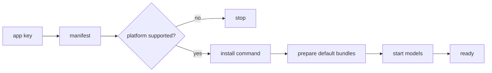

# FlashHub application manifest standard (v1)

<p align="right"><strong>English</strong> · <a href="app_manifest_standard.zh-CN.md">简体中文</a></p>

An **application manifest** (`flashcli-application`) describes how to install a
FlashHub application and which model bundles it needs. It is declarative data
only: FlashHub owns the manifest, `flashcli` executes it under the rules below.

This document is authoritative for `app_format_version: 1`, matching what
FlashHub serves today. It is referenced by [plans/application_install_plan.md](plans/application_install_plan.md).

## Flow



## Format and versioning

| Field | Meaning |
|---|---|
| `format` | Fixed `flashcli-application`. |
| `app_format_version` | Manifest schema version. Currently `1` and frozen; a breaking schema change bumps it and older hosts must refuse it. |
| `protocol_version` | FlashHub ↔ flashcli protocol version. Currently `1`, independent of the app version. |
| `version` | Application version. Immutable: the same `version` must never be republished with different content. |

Unknown **top-level** fields are ignored (forward compatibility). A missing or
invalid required field is rejected with the field name. An unsupported
`app_format_version` is rejected with an upgrade hint.

## App key

```text
[namespace/]name[:version]
```

- `namespace` is the FlashHub organization (`xym`, `YaomuAI`, …).
- Omitting `version` resolves the latest version; installs should pin it.
- `GET /api/v1/apps/{namespace}/{name}` and
  `GET /api/v1/apps/{namespace}/{name}:{version}` return the manifest.

## Fields

| Field | Required | Semantics |
|---|---|---|
| `format` | yes | `flashcli-application` |
| `app_format_version` | yes | `1` |
| `protocol_version` | yes | `1` |
| `name` | yes | Application name; must match the app key name |
| `version` | yes | Immutable application version |
| `display_name` | no | Human-readable name for clients |
| `supported.os` | yes | `windows`, `linux`, `darwin` |
| `supported.arch` | yes | `x86_64`, `arm64` (`amd64` is normalized to `x86_64`) |
| `install.commands` | yes | Map of `<os>` or `<os>/<arch>` → download URL **or** shell command |
| `model.bundles[]` | yes | Model bundles the application uses |
| `model.bundles[].bundle` | yes | Model Bundle ref `[namespace/]name:version` |
| `model.bundles[].default` | no | Prepare this bundle by default (default `false`) |
| `model.bundles[].serve.options` | no | Options passed to `flashcli serve` (must be declared by the bundle) |
| `config[]` | no | Reserved for configuration rules; empty in v1 |
| `setup.scripts[]` | no | Client-side configuration scripts run after models are ready |

## install.commands

- Keys are `<os>` (`windows`, `linux`, `darwin`) or `<os>/<arch>`
  (`darwin/arm64`). The host prefers the more specific key and falls back to
  `<os>`.
- Values are either a **URL** (download page or installer) or a **shell
  command** (`curl … | bash`, `irm … | iex`).
- URLs are never downloaded automatically: the host prints them (and may offer
  to open them). The install is recorded as `manual`.
- Shell commands require explicit confirmation (`[y/N]`). Non-interactive runs
  without `--yes` **skip** the command and record `skipped`; they never execute
  silently.
- A failed command aborts the install (no model preparation follows).

## model.bundles

- The host prepares **every** bundle with `default: true` sequentially (bundle
  tree, venv, weights); `--bundle` overrides the selection. If no bundle is
  marked default, the first one is used. Install stops there: models are **not**
  started.
- `flashcli app start` (or the desktop 启动 button) starts the prepared group
  with automatically allocated ports and health-checks each endpoint.
- `serve.options` values are forwarded as `--flag value`; the bundle's
  `serve_options` remains authoritative for names and defaults.

## Updating a model bundle

Bundle versions are **immutable**: the cache key, marker and weights store are
derived from the version/revision, so changing a bundle's content under an
existing version is not picked up by `run`/`serve`/`pull` (the cached tree is
treated as complete).

To update:

1. Publish a new bundle version (for example `xym/demo:1.0.2`) with the new
   content/weights revision.
2. Update the application manifest's `model.bundles[].bundle` to the new ref
   (publish a new application version if your process treats app versions as
   immutable).
3. Reinstall the application (`重新安装` in the desktop, or
   `flashcli app install <app> --force`).

Reinstall fetches the current manifest, stops every running model of the app
(freeing slots/VRAM), keeps the caches, and prepares the new bundles — install
does not start them. Starting the app afterwards runs the confirmed setup
scripts for the new connection. Old caches are not deleted automatically; use
`flashcli bundle clean --all <old-ref>` when they are no longer needed.

A new **application** version is a separate app key: install it and stop or
uninstall the old version. Updating the bundle refs in place under the same
application version is supported by reinstall, but publishing a new app version
is the documented/immutable path.

For an in-place cache refresh of the **same** version (for example a mutable
`main` revision or a repaired cache), the model page exposes **更多 → 重新同步**
only while the model is not running. It calls
`POST /api/v1/pull {"ref": "...", "force": true}` (CLI:
`flashcli pull <ref> --force`), re-downloading the bundle tree/manifest and
re-verifying weights. Treat this as a repair path; normal content updates should
publish a new bundle version.

## config (reserved)

`config` is part of the schema but v1 applications publish an empty array. Hosts
must accept it and ignore unknown entries; configuration rewriting via `config`
will be specified separately when the format is final. Use `setup.scripts` for
the v1 client-side configuration hook described below.

## setup.scripts (client configuration)

Optional list of client-side scripts that configure the installed application
after its models are ready. The script receives the app's connection and writes
the application's own config (for example a custom OpenAI-compatible model
entry).

| Field | Required | Semantics |
|---|---|---|
| `key` | yes | Unique id within the app; used for consent and logs |
| `kind` | yes | `python` (v1) |
| `url` | yes | HTTPS URL of the script; downloaded by the client |
| `sha256` | yes | 64 hex chars; must match the downloaded bytes or the script is not run |
| `args` | no | Explicit argv template; every entry is appended |

```json
"setup": {
  "scripts": [{
    "key": "workbuddy",
    "kind": "python",
    "url": "https://flashhub-cdn.aodianyun.com/tools/model-setup/model_setup_workbuddy.py",
    "sha256": "…64 hex…",
    "args": ["{base_url}", "{model}", "--api-key {api_key}"]
  }]
}
```

Rules:

- Placeholders are exactly `{base_url}`, `{model}`, `{api_key}` (the installed
  app's connection); unknown placeholders are invalid.
- Each `args` entry is appended after substitution. An entry may contain spaces
  and is split into argv tokens (values must not contain spaces in v1). Use
  `"--api-key {api_key}"`, not `"--api-key={api_key}"`.
- The script runs in the **client's home context** after the models become
  ready. The desktop confirms; when flashserver runs in WSL it executes the
  script with `HOME` mapped to the client home so the application's real config
  is written. The model port changes on every start and a restored app replays
  the selected scripts, so the script must be idempotent.
- The user confirms the selection on every manual start (desktop dialog; a
  prompt per script in the CLI). The confirmed definitions (URL/`sha256`/args),
  keys, and client home are persisted, so a daemon restart restores the app and
  automatically runs the same scripts once the models are ready (no manifest
  fetch is needed; the script still receives the new `{base_url}`/`{model}`/
  `{api_key}`). Selecting no scripts clears the saved selection.
- Scripts run in manifest order; the first failure stops the remaining scripts
  and is reported in the app log. The running app stays `ready`.
- Download and `sha256` verification happen before execution. A mismatch is
  retried once (CDN edges can briefly serve a stale variant), then reported in
  the app log and never executed. A verified script is cached by `sha256`
  under `~/.flashcli/setup-cache/`, so a restore can replay it without the
  network; the running app is not marked failed.
- Scripts must only modify the application's own configuration.
- App versions are immutable: publish a new app version when adding or changing
  setup scripts.

## Host-owned behavior

The manifest deliberately does **not** define:

- **Ports** — allocated by the host, recorded, reused when free.
- **Health checks** — the host probes `/health` (native backends also accept
  `/healthz`).
- **Service lifecycle** — reuse the resident `flashserver` when present;
  otherwise `flashcli app` supervises `flashcli serve` processes itself.
- **Config files** — `config[]` is out of scope in v1; `setup.scripts` is the
  client-side hook (the host supplies the connection and verifies the script).
- **System capabilities** — validated from the model bundle.
- **Download integrity** — install commands have no checksum (user-confirmed);
  `setup.scripts` require `sha256`.

## Examples

### GUI application (URL install)

```json
{
  "format": "flashcli-application",
  "app_format_version": 1,
  "protocol_version": 1,
  "name": "YaomuStudio",
  "version": "1.0.0",
  "display_name": "YaomuStudio",
  "supported": {"os": ["windows", "linux"], "arch": ["x86_64", "arm64"]},
  "install": {"commands": {
    "windows": "https://example.com/YaoMuStudio-win-x64.exe",
    "linux": "https://example.com/YaoMuStudio-linux-x64.AppImage"
  }},
  "model": {"bundles": [
    {"bundle": "YaomuAI/melband-roformer:1.0.11", "default": true, "serve": {"options": {}}},
    {"bundle": "YaomuAI/qwen3_asr:1.0.1", "default": true, "serve": {"options": {}}}
  ]},
  "config": []
}
```

### CLI application (shell install)

```json
{
  "format": "flashcli-application",
  "app_format_version": 1,
  "protocol_version": 1,
  "name": "grok",
  "version": "1.0.0",
  "display_name": "Grok CLI",
  "supported": {"os": ["linux", "darwin", "windows"], "arch": ["x86_64", "arm64"]},
  "install": {"commands": {
    "darwin/arm64": "curl -fsSL https://x.ai/cli/install.sh | bash",
    "linux": "curl -fsSL https://x.ai/cli/install.sh | bash",
    "windows": "irm https://x.ai/cli/install.ps1 | iex"
  }},
  "model": {"bundles": [
    {"bundle": "xym/gemma4_e2b_it:1.0.1", "default": true, "serve": {"options": {}}}
  ]},
  "config": []
}
```

## Compatibility

- Adding optional fields keeps `app_format_version: 1`.
- Removing or changing the meaning of a field requires `2`; hosts reject newer
  versions instead of guessing.
- Hosts must keep unknown top-level fields and unknown `config[]` entries
  intact when echoing the manifest.
