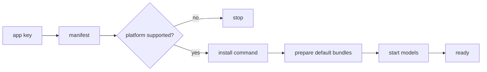

# FlashHub application manifest standard (v1)

<p align="right"><strong>English</strong> · <a href="app_manifest_standard.zh-CN.md">简体中文</a></p>

An **application manifest** (`flashcli-application`) describes how to install a
FlashHub application and which model bundles it needs. It is declarative data
only: FlashHub owns the manifest, `flashcli` executes it under the rules below.

This document is authoritative for `app_format_version: 1`, matching what
FlashHub serves today. It is referenced by [application_install_plan.md](application_install_plan.md).

## Flow



## Format and versioning

| Field | Meaning |
|---|---|
| `format` | Fixed `flashcli-application`. |
| `app_format_version` | Manifest schema version. Currently `1` and frozen; a breaking schema change bumps it and older hosts must refuse it. |
| `protocol_version` | FlashHub ↔ flashcli protocol version. Currently `1`, independent of the app version. |
| `version` | Application version. Immutable: the same `version` must never be republished with different content. |

Unknown **top-level** fields are ignored (forward compatibility). A missing or
invalid required field is rejected with the field name. An unsupported
`app_format_version` is rejected with an upgrade hint.

## App key

```text
[namespace/]name[:version]
```

- `namespace` is the FlashHub organization (`xym`, `YaomuAI`, …).
- Omitting `version` resolves the latest version; installs should pin it.
- `GET /api/v1/apps/{namespace}/{name}` and
  `GET /api/v1/apps/{namespace}/{name}:{version}` return the manifest.

## Fields

| Field | Required | Semantics |
|---|---|---|
| `format` | yes | `flashcli-application` |
| `app_format_version` | yes | `1` |
| `protocol_version` | yes | `1` |
| `name` | yes | Application name; must match the app key name |
| `version` | yes | Immutable application version |
| `display_name` | no | Human-readable name for clients |
| `supported.os` | yes | `windows`, `linux`, `darwin` |
| `supported.arch` | yes | `x86_64`, `arm64` (`amd64` is normalized to `x86_64`) |
| `install.commands` | yes | Map of `<os>` or `<os>/<arch>` → download URL **or** shell command |
| `model.bundles[]` | yes | Model bundles the application uses |
| `model.bundles[].bundle` | yes | Model Bundle ref `[namespace/]name:version` |
| `model.bundles[].default` | no | Prepare this bundle by default (default `false`) |
| `model.bundles[].serve.options` | no | Options passed to `flashcli serve` (must be declared by the bundle) |
| `config[]` | no | Reserved for configuration rules; empty in v1 |

## install.commands

- Keys are `<os>` (`windows`, `linux`, `darwin`) or `<os>/<arch>`
  (`darwin/arm64`). The host prefers the more specific key and falls back to
  `<os>`.
- Values are either a **URL** (download page or installer) or a **shell
  command** (`curl … | bash`, `irm … | iex`).
- URLs are never downloaded automatically: the host prints them (and may offer
  to open them). The install is recorded as `manual`.
- Shell commands require explicit confirmation (`[y/N]`). Non-interactive runs
  without `--yes` **skip** the command and record `skipped`; they never execute
  silently.
- A failed command aborts the install (no model preparation follows).

## model.bundles

- The host prepares **every** bundle with `default: true`; `--bundle` overrides
  the selection. If no bundle is marked default, the first one is used.
- Bundles are prepared sequentially (bundle tree, venv, weights).
- After all default bundles are prepared, they are started as one group with
  automatically allocated ports; each model endpoint is health-checked.
- `serve.options` values are forwarded as `--flag value`; the bundle's
  `serve_options` remains authoritative for names and defaults.

## config (reserved)

`config` is part of the schema but v1 applications publish an empty array. Hosts
must accept it and ignore unknown entries; configuration rewriting will be
specified separately when the format is final. Until then the host writes a
`connection.json` (base URL, model ids, local API key) instead of editing
application files.

## Host-owned behavior

The manifest deliberately does **not** define:

- **Ports** — allocated by the host, recorded, reused when free.
- **Health checks** — the host probes `/health` (native backends also accept
  `/healthz`).
- **Service lifecycle** — reuse the resident `flashserver` when present;
  otherwise `flashcli app` supervises `flashcli serve` processes itself.
- **Config files** — out of scope in v1.
- **System capabilities** — validated from the model bundle.
- **Download integrity** — no checksums in v1; shell commands are confirmed by
  the user.

## Examples

### GUI application (URL install)

```json
{
  "format": "flashcli-application",
  "app_format_version": 1,
  "protocol_version": 1,
  "name": "YaomuStudio",
  "version": "1.0.0",
  "display_name": "YaomuStudio",
  "supported": {"os": ["windows", "linux"], "arch": ["x86_64", "arm64"]},
  "install": {"commands": {
    "windows": "https://example.com/YaoMuStudio-win-x64.exe",
    "linux": "https://example.com/YaoMuStudio-linux-x64.AppImage"
  }},
  "model": {"bundles": [
    {"bundle": "YaomuAI/melband-roformer:1.0.11", "default": true, "serve": {"options": {}}},
    {"bundle": "YaomuAI/qwen3_asr:1.0.1", "default": true, "serve": {"options": {}}}
  ]},
  "config": []
}
```

### CLI application (shell install)

```json
{
  "format": "flashcli-application",
  "app_format_version": 1,
  "protocol_version": 1,
  "name": "grok",
  "version": "1.0.0",
  "display_name": "Grok CLI",
  "supported": {"os": ["linux", "darwin", "windows"], "arch": ["x86_64", "arm64"]},
  "install": {"commands": {
    "darwin/arm64": "curl -fsSL https://x.ai/cli/install.sh | bash",
    "linux": "curl -fsSL https://x.ai/cli/install.sh | bash",
    "windows": "irm https://x.ai/cli/install.ps1 | iex"
  }},
  "model": {"bundles": [
    {"bundle": "xym/gemma4_e2b_it:1.0.1", "default": true, "serve": {"options": {}}}
  ]},
  "config": []
}
```

## Compatibility

- Adding optional fields keeps `app_format_version: 1`.
- Removing or changing the meaning of a field requires `2`; hosts reject newer
  versions instead of guessing.
- Hosts must keep unknown top-level fields and unknown `config[]` entries
  intact when echoing the manifest.
