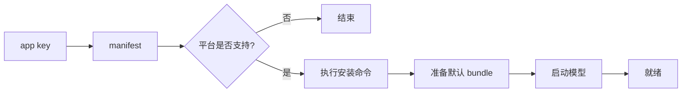

# FlashHub 应用 manifest 规范（v1）

<p align="right"><a href="app_manifest_standard.md">English</a> · <strong>简体中文</strong></p>

**应用 manifest**（`flashcli-application`）描述一个 FlashHub 应用如何安装、需要哪些模型
bundle。它只是声明式数据：FlashHub 拥有 manifest，`flashcli` 按下面的规则执行。

本文档是 `app_format_version: 1` 的权威定义，与 FlashHub 当前实际下发的内容一致；由
[application_install_plan.zh-CN.md](application_install_plan.zh-CN.md) 引用。

## 流程



## 格式与版本

| 字段 | 含义 |
|---|---|
| `format` | 固定 `flashcli-application` |
| `app_format_version` | manifest 规范版本。当前 `1` 并冻结；破坏性变更才升版本，旧 host 必须拒绝 |
| `protocol_version` | FlashHub ↔ flashcli 协议版本。当前 `1`，与应用版本无关 |
| `version` | 应用版本。**不可变**：同一版本不得以不同内容重新发布 |

未知的**顶层**字段忽略（向前兼容）；必填字段缺失或非法时拒绝，并指出字段名；
`app_format_version` 不支持时拒绝并提示升级。

## App key

```text
[namespace/]name[:version]
```

- `namespace` 是 FlashHub 组织（`xym`、`YaomuAI` 等）
- 省略 `version` 解析最新版本；安装应固定版本
- `GET /api/v1/apps/{namespace}/{name}` 与
  `GET /api/v1/apps/{namespace}/{name}:{version}` 返回 manifest

## 字段

| 字段 | 必填 | 语义 |
|---|---|---|
| `format` | 是 | `flashcli-application` |
| `app_format_version` | 是 | `1` |
| `protocol_version` | 是 | `1` |
| `name` | 是 | 应用名，必须与 app key 的 name 一致 |
| `version` | 是 | 不可变的应用版本 |
| `display_name` | 否 | 客户端展示名 |
| `supported.os` | 是 | `windows`、`linux`、`darwin` |
| `supported.arch` | 是 | `x86_64`、`arm64`（`amd64` 归一化为 `x86_64`） |
| `install.commands` | 是 | `<os>` 或 `<os>/<arch>` → 下载 URL **或** shell 命令 |
| `model.bundles[]` | 是 | 应用使用的模型 bundle |
| `model.bundles[].bundle` | 是 | Model Bundle ref `[namespace/]name:version` |
| `model.bundles[].default` | 否 | 默认准备该 bundle（缺省 `false`） |
| `model.bundles[].serve.options` | 否 | 传给 `flashcli serve` 的选项（必须由 bundle 声明） |
| `config[]` | 否 | 预留的配置规则；v1 为空数组 |

## install.commands

- 键为 `<os>`（`windows`/`linux`/`darwin`）或 `<os>/<arch>`（如 `darwin/arm64`）；
  host 优先使用更具体的键，找不到再回退 `<os>`
- 值要么是 **URL**（下载页或安装包），要么是 **shell 命令**（`curl … | bash`、
  `irm … | iex`）
- URL **不会自动下载**：host 打印（可选打开），安装记录为 `manual`
- shell 命令必须显式确认（`[y/N]`）；非交互且没有 `--yes` 时**跳过**并记录
  `skipped`，绝不静默执行
- 命令失败立即终止安装（不再准备模型）

## model.bundles

- host 准备**所有** `default: true` 的 bundle；`--bundle` 可覆盖选择；
  若没有任何 default，则使用第一个
- 逐个**串行**准备（bundle 树、venv、权重）
- 全部准备完成后，作为**一组**启动：自动分配端口，逐个健康检查
- `serve.options` 以 `--flag value` 形式转发；选项名与默认值仍由 bundle 的
  `serve_options` 决定

## config（预留）

`config` 属于 schema，但 v1 应用全部发布空数组。host 必须接受并忽略未知条目；
配置改写待格式定稿后单独规范。在此之前 host 只写 `connection.json`（base URL、
模型 id、本地 API key），不修改应用自身文件。

## 由 host 决定的行为

manifest 刻意**不**定义：

- **端口** —— host 自动分配、记录，空闲时复用
- **健康检查** —— host 探测 `/health`（native 后端同时接受 `/healthz`）
- **服务生命周期** —— 有常驻 `flashserver` 时复用；否则 `flashcli app` 自行监管
  `flashcli serve` 进程
- **配置文件** —— v1 不涉及
- **系统能力** —— 由模型 bundle 预检
- **下载完整性** —— v1 无校验和；shell 命令由用户确认

## 示例

### GUI 应用（URL 安装）

```json
{
  "format": "flashcli-application",
  "app_format_version": 1,
  "protocol_version": 1,
  "name": "YaomuStudio",
  "version": "1.0.0",
  "display_name": "YaomuStudio",
  "supported": {"os": ["windows", "linux"], "arch": ["x86_64", "arm64"]},
  "install": {"commands": {
    "windows": "https://example.com/YaoMuStudio-win-x64.exe",
    "linux": "https://example.com/YaoMuStudio-linux-x64.AppImage"
  }},
  "model": {"bundles": [
    {"bundle": "YaomuAI/melband-roformer:1.0.11", "default": true, "serve": {"options": {}}},
    {"bundle": "YaomuAI/qwen3_asr:1.0.1", "default": true, "serve": {"options": {}}}
  ]},
  "config": []
}
```

### CLI 应用（shell 安装）

```json
{
  "format": "flashcli-application",
  "app_format_version": 1,
  "protocol_version": 1,
  "name": "grok",
  "version": "1.0.0",
  "display_name": "Grok CLI",
  "supported": {"os": ["linux", "darwin", "windows"], "arch": ["x86_64", "arm64"]},
  "install": {"commands": {
    "darwin/arm64": "curl -fsSL https://x.ai/cli/install.sh | bash",
    "linux": "curl -fsSL https://x.ai/cli/install.sh | bash",
    "windows": "irm https://x.ai/cli/install.ps1 | iex"
  }},
  "model": {"bundles": [
    {"bundle": "xym/gemma4_e2b_it:1.0.1", "default": true, "serve": {"options": {}}}
  ]},
  "config": []
}
```

## 兼容规则

- 新增可选字段保持 `app_format_version: 1`
- 删除字段或改变语义必须升到 `2`；host 拒绝更高版本而不是猜测
- host 回显 manifest 时必须保留未知顶层字段与未知 `config[]` 条目
