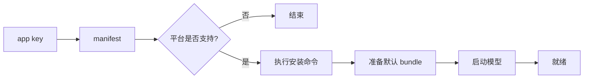

# FlashHub 应用 manifest 规范（v1）

<p align="right"><a href="app_manifest_standard.md">English</a> · <strong>简体中文</strong></p>

**应用 manifest**（`flashcli-application`）描述一个 FlashHub 应用如何安装、需要哪些模型
bundle。它只是声明式数据：FlashHub 拥有 manifest，`flashcli` 按下面的规则执行。

本文档是 `app_format_version: 1` 的权威定义，与 FlashHub 当前实际下发的内容一致；由
[application_install_plan.zh-CN.md](application_install_plan.zh-CN.md) 引用。

## 流程



## 格式与版本

| 字段 | 含义 |
|---|---|
| `format` | 固定 `flashcli-application` |
| `app_format_version` | manifest 规范版本。当前 `1` 并冻结；破坏性变更才升版本，旧 host 必须拒绝 |
| `protocol_version` | FlashHub ↔ flashcli 协议版本。当前 `1`，与应用版本无关 |
| `version` | 应用版本。**不可变**：同一版本不得以不同内容重新发布 |

未知的**顶层**字段忽略（向前兼容）；必填字段缺失或非法时拒绝，并指出字段名；
`app_format_version` 不支持时拒绝并提示升级。

## App key

```text
[namespace/]name[:version]
```

- `namespace` 是 FlashHub 组织（`xym`、`YaomuAI` 等）
- 省略 `version` 解析最新版本；安装应固定版本
- `GET /api/v1/apps/{namespace}/{name}` 与
  `GET /api/v1/apps/{namespace}/{name}:{version}` 返回 manifest

## 字段

| 字段 | 必填 | 语义 |
|---|---|---|
| `format` | 是 | `flashcli-application` |
| `app_format_version` | 是 | `1` |
| `protocol_version` | 是 | `1` |
| `name` | 是 | 应用名，必须与 app key 的 name 一致 |
| `version` | 是 | 不可变的应用版本 |
| `display_name` | 否 | 客户端展示名 |
| `supported.os` | 是 | `windows`、`linux`、`darwin` |
| `supported.arch` | 是 | `x86_64`、`arm64`（`amd64` 归一化为 `x86_64`） |
| `install.commands` | 是 | `<os>` 或 `<os>/<arch>` → 下载 URL **或** shell 命令 |
| `model.bundles[]` | 是 | 应用使用的模型 bundle |
| `model.bundles[].bundle` | 是 | Model Bundle ref `[namespace/]name:version` |
| `model.bundles[].default` | 否 | 默认准备该 bundle（缺省 `false`） |
| `model.bundles[].serve.options` | 否 | 传给 `flashcli serve` 的选项（必须由 bundle 声明） |
| `config[]` | 否 | 预留的配置规则；v1 为空数组 |
| `setup.scripts[]` | 否 | 客户端配置脚本（模型就绪后写入应用配置） |

## install.commands

- 键为 `<os>`（`windows`/`linux`/`darwin`）或 `<os>/<arch>`（如 `darwin/arm64`）；
  host 优先使用更具体的键，找不到再回退 `<os>`
- 值要么是 **URL**（下载页或安装包），要么是 **shell 命令**（`curl … | bash`、
  `irm … | iex`）
- URL **不会自动下载**：host 打印（可选打开），安装记录为 `manual`
- shell 命令必须显式确认（`[y/N]`）；非交互且没有 `--yes` 时**跳过**并记录
  `skipped`，绝不静默执行
- 命令失败立即终止安装（不再准备模型）

## model.bundles

- host 准备**所有** `default: true` 的 bundle；`--bundle` 可覆盖选择；
  若没有任何 default，则使用第一个
- 逐个**串行**准备（bundle 树、venv、权重）
- 全部准备完成后，作为**一组**启动：自动分配端口，逐个健康检查
- `serve.options` 以 `--flag value` 形式转发；选项名与默认值仍由 bundle 的
  `serve_options` 决定

## 更新模型 bundle

bundle 版本是**不可变**的：cache key、marker 和权重 store 都由版本/revision 派生，
因此在同一版本下替换 bundle 内容不会被 `run`/`serve`/`pull` 识别（缓存视为完整）。

更新步骤：

1. 发布新的 bundle 版本（例如 `xym/demo:1.0.2`），包含新内容/权重 revision。
2. 把应用 manifest 的 `model.bundles[].bundle` 改成新 ref（如果流程要求应用版本不可变，
   同时发布新的应用版本）。
3. 重新安装应用（桌面端「重新安装」，或 `flashcli app install <app> --force`）。

重新安装会重新拉取 manifest、停止不再被引用的旧模型（释放槽位/显存，保留缓存）、
准备并启动新 bundle，然后针对新的接入地址执行已确认的配置脚本。旧缓存不会自动删除，
确认不再需要时用 `flashcli bundle clean --all <old-ref>` 清理。

新的**应用**版本是一个新的 app key：安装新版本并停止/卸载旧版本。同一应用版本下直接
更新 bundle ref 也支持重新安装，但发布新应用版本才是符合不可变约定的路径。

如果确实需要在**同一版本**下刷新缓存（例如可变的 `main` revision 或缓存修复），模型页
提供 **更多 → 重新同步**，仅在模型未运行时可用。它调用
`POST /v1/pull {"ref": "...", "force": true}`（CLI：`flashcli pull <ref> --force`），
重新下载 bundle 树/manifest 并重新校验权重。这是修复路径；正常内容更新应发布新的 bundle
版本。

## config（预留）

`config` 属于 schema，但 v1 应用全部发布空数组。host 必须接受并忽略未知条目；
通过 `config` 的配置改写待格式定稿后单独规范。v1 的客户端配置钩子请使用
`setup.scripts`。

## setup.scripts（客户端配置）

可选的客户端脚本列表，在应用模型就绪后配置已安装的应用。脚本会拿到应用的连接
信息，写入应用自己的配置文件（例如新增一个 OpenAI 兼容的自定义模型）。

| 字段 | 必填 | 语义 |
|---|---|---|
| `key` | 是 | 应用内唯一标识；用于确认记忆和日志 |
| `kind` | 是 | `python`（v1） |
| `url` | 是 | 脚本的 HTTPS 地址，由客户端下载 |
| `sha256` | 是 | 64 位十六进制；必须与下载内容一致，否则不执行 |
| `args` | 否 | 显式 argv 模板；每一项都会追加 |

```json
"setup": {
  "scripts": [{
    "key": "workbuddy",
    "kind": "python",
    "url": "https://flashhub-cdn.aodianyun.com/tools/model-setup/model_setup_workbuddy.py",
    "sha256": "…64 位…",
    "args": ["{base_url}", "{model}", "--api-key {api_key}"]
  }]
}
```

规则：

- 占位符仅 `{base_url}`、`{model}`、`{api_key}`（已安装应用的连接信息）；未知占位符非法
- `args` 每一项替换后追加；可以包含空格，替换后按空格拆成 argv token
  （v1 中值不能含空格）。写成 `"--api-key {api_key}"`，不要写 `"--api-key={api_key}"`
- 脚本在**客户端 home 上下文**中、模型就绪后执行；桌面端负责确认，flashserver 在
  WSL 中运行时会把 `HOME` 映射到客户端 home，从而写入应用的真实配置。每次启动都会
  重新执行（端口会变），必须幂等
- **每次执行都需要用户确认**（桌面端每次启动/安装的确认框，CLI 对每个脚本的提示），
  不记住同意
- daemon 重启后应用会以新接入地址恢复；桌面端发现记录的 `setup_for` 与当前地址不一致时，
  会再次询问并重跑脚本
- 脚本按 manifest 顺序执行；第一个失败会停止后续脚本并写入应用日志，运行中的应用
  保持 `ready`
- 执行前下载并校验 `sha256`；不匹配或非零退出只写入应用日志，不把运行中的应用标成失败
- 脚本只能修改应用自身的配置
- 应用版本不可变：新增/修改 `setup` 脚本时发布新的应用版本

## 由 host 决定的行为

manifest 刻意**不**定义：

- **端口** —— host 自动分配、记录，空闲时复用
- **健康检查** —— host 探测 `/health`（native 后端同时接受 `/healthz`）
- **服务生命周期** —— 有常驻 `flashserver` 时复用；否则 `flashcli app` 自行监管
  `flashcli serve` 进程
- **配置文件** —— `config[]` 在 v1 不涉及；`setup.scripts` 是客户端钩子
  （host 提供连接信息并校验脚本）
- **系统能力** —— 由模型 bundle 预检
- **下载完整性** —— 安装命令无校验和（由用户确认）；`setup.scripts` 必须提供 `sha256`

## 示例

### GUI 应用（URL 安装）

```json
{
  "format": "flashcli-application",
  "app_format_version": 1,
  "protocol_version": 1,
  "name": "YaomuStudio",
  "version": "1.0.0",
  "display_name": "YaomuStudio",
  "supported": {"os": ["windows", "linux"], "arch": ["x86_64", "arm64"]},
  "install": {"commands": {
    "windows": "https://example.com/YaoMuStudio-win-x64.exe",
    "linux": "https://example.com/YaoMuStudio-linux-x64.AppImage"
  }},
  "model": {"bundles": [
    {"bundle": "YaomuAI/melband-roformer:1.0.11", "default": true, "serve": {"options": {}}},
    {"bundle": "YaomuAI/qwen3_asr:1.0.1", "default": true, "serve": {"options": {}}}
  ]},
  "config": []
}
```

### CLI 应用（shell 安装）

```json
{
  "format": "flashcli-application",
  "app_format_version": 1,
  "protocol_version": 1,
  "name": "grok",
  "version": "1.0.0",
  "display_name": "Grok CLI",
  "supported": {"os": ["linux", "darwin", "windows"], "arch": ["x86_64", "arm64"]},
  "install": {"commands": {
    "darwin/arm64": "curl -fsSL https://x.ai/cli/install.sh | bash",
    "linux": "curl -fsSL https://x.ai/cli/install.sh | bash",
    "windows": "irm https://x.ai/cli/install.ps1 | iex"
  }},
  "model": {"bundles": [
    {"bundle": "xym/gemma4_e2b_it:1.0.1", "default": true, "serve": {"options": {}}}
  ]},
  "config": []
}
```

## 兼容规则

- 新增可选字段保持 `app_format_version: 1`
- 删除字段或改变语义必须升到 `2`；host 拒绝更高版本而不是猜测
- host 回显 manifest 时必须保留未知顶层字段与未知 `config[]` 条目
