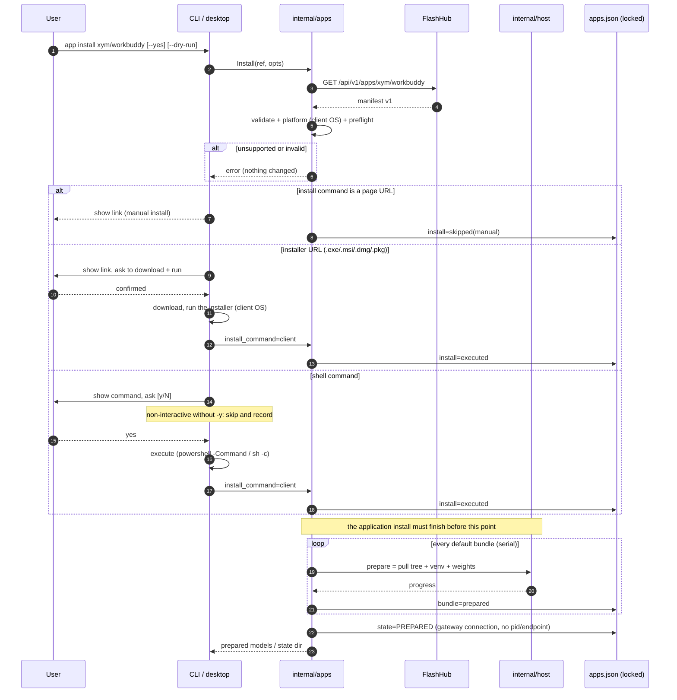
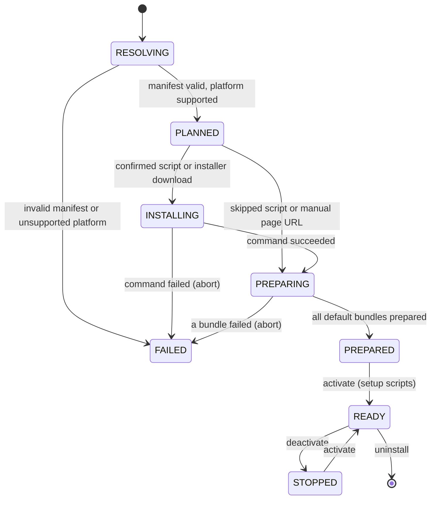

# FlashHub application install plan

<p align="right"><strong>English</strong> · <a href="application_install_plan.zh-CN.md">简体中文</a></p>

> **Status: implemented (v1).** The manifest schema is specified in
> [app_manifest_standard.md](app_manifest_standard.md) (v1, matching FlashHub).

## Goals

One command installs an application, prepares its models, and leaves them ready:

```bash
flashcli app install xym/workbuddy
```

`flashcli` must work **without** a running `flashserver`; the daemon and the CLI
share one Go implementation (`internal/apps`), and the desktop talks to the
daemon over HTTP only.

## Terminology

| Term | Meaning |
|---|---|
| **Application** | An external app published on FlashHub (`xym/workbuddy`) |
| **App key** | `[namespace/]name[:version]` |
| **Manifest** | `flashcli-application` document (see the manifest standard) |
| **Model bundle** | Existing `flashcli-bundle/<name>:<version>` runtime |
| **Resident daemon** | `flashserver` (unchanged: scheduler, console, API) |

## Responsibilities

| Component | Owns |
|---|---|
| FlashHub | App registry, versions, manifest validation, metadata |
| `internal/apps` (shared) | Manifest use, install policy, app state, model preparation and lifecycle |
| `internal/modelrun` (shared) | Supervising `flashcli serve` children (ports, health, logs, stop) |
| `flashcli` CLI | User interaction, confirmations, exit codes, JSON output |
| `flashserver` | HTTP API used by the desktop; calls the same shared package |
| `flashcli-desktop` | UI only; HTTP/WS to `flashserver` |

No HTTP call from the CLI to the daemon is required (or used) for app operations.

## App key

`xym/workbuddy` resolves the latest version; `xym/workbuddy:1.0.0` pins it.
`flashcli app install` records the resolved version.

## Manifest

`GET /api/v1/apps/{namespace}/{name}[:version]` returns the manifest. The host
validates `format`, `app_format_version`, `protocol_version`, required fields,
and that `name`/`version` match the key. See
[app_manifest_standard.md](app_manifest_standard.md).

## Install flow

Install and activation are **separate operations**. Install resolves and
validates the manifest, installs the application itself, and prepares the model
bundles. It never starts a model and never runs setup scripts. Activation is an
explicit action (desktop 启用 / `POST /api/v1/apps/.../activate`) that runs the
confirmed setup scripts against the flashserver gateway.

```text
RESOLVE → VALIDATE → PLATFORM → PREFLIGHT → PLAN
  → CONFIRM_INSTALL (shell command or installer download; page URL: manual)
  → INSTALL_APP (script: run | installer URL: download + run | page: open/copy)
  → PREPARE_MODELS (every default bundle, serial)
  → PREPARED (cached; gateway connection recorded; nothing running)
```



### Activation flow (separate action)

```text
ACTIVATE → READY + gateway connection → SETUP_SCRIPTS (confirmed, manifest order)
```

Activation does **not** start a model. It marks the app ready, writes the
gateway connection (`http://<host>:<port>/v1`) and runs the confirmed setup
scripts with `{base_url}` bound to that gateway. A setup failure leaves the app
`READY` with `setup_error`. Deactivation marks the app `STOPPED`; no process is
stopped because models belong to the flashserver scheduler. Reinstalling keeps
caches and returns the app to `PREPARED`.

### State machine



`status` reports the stored activation state. Activation and deactivation are
serialized per application. Apps never store a model PID or child endpoint; the
gateway connection is stable and inference starts on demand.

On daemon start, an interrupted `installing`/`preparing` becomes `failed` with a
reinstall hint; `starting`/`stopping` are no longer used for app models.

### Setup scripts (optional)

On activation the host runs the manifest's `setup.scripts` in manifest order for
the keys the user confirmed **for this run**. The client (the desktop dialog or
the CLI prompt per script) is the confirmation point. Each script is downloaded,
verified against `sha256`, and executed with the explicit argv template
(`{base_url}` = flashserver gateway, `{model}`, `{api_key}`). A failure is
written to the app job log and stops the remaining scripts; the app stays
`READY`. Apps without `setup.scripts` skip this step. The confirmed selection is
persisted for the next activation.

### Failure and rollback

- **Install-command failure** aborts immediately; no model preparation runs.
- **Prepare failure** aborts; prepared bundles stay cached (a re-run resumes).
- **Start/health failure** stops the models started by that run
  (`--keep-partial` keeps them for debugging).
- **Setup-script failure** is written to the app log, stops the remaining
  scripts, and leaves the running app `ready` (the models are not rolled back).
- Re-running `app install` is idempotent: it fills missing prepare steps and
  only re-runs the install script with `--force`; it never starts models.

## Commands

```bash
flashcli app list   [--json]
flashcli app show   <key> [--json]
flashcli app install <key> [--yes|-y] [--dry-run] [--force]
                     [--bundle REF]... [--no-install] [--no-model]
flashcli app status <key> [--json]
flashcli app logs   <key> [--ref REF] [--lines N] [-f]
flashcli app uninstall <key> [--yes] [--purge-models]
```

Rules:

- Any shell execution requires explicit confirmation; `--yes` runs it without a
  prompt; non-interactive runs without `--yes` skip it and record `skipped`.
- URLs are handled by the client: the CLI prints the link and never downloads;
  the desktop, after confirmation, downloads and runs installers
  (.exe/.msi on Windows, .dmg/.pkg on macOS) and opens plain pages in a browser.
- Bundles are prepared only after the application install succeeded; a failed
  install (script or installer) aborts the whole run.
- Installs are serialized per application; the desktop additionally allows one
  install at a time and disables the other apps while an install job runs (its
  card and the page banner show the progress). Activation/deactivation are
  serialized per application too.
- Inference starts on demand through the flashserver gateway; the app has no
  allocated model port and no model start/stop command.
- `uninstall` removes the app state; model caches are kept unless
  `--purge-models` is given.

## Entry points

The CLI, the daemon and the desktop all drive the same `internal/apps` service;
only the way the install-script decision is obtained differs:

| Entry point | Install-script decision |
|---|---|
| `flashcli app install` | asks `[y/N]` on a terminal; `--yes` runs it; no terminal without `--yes` skips and records `skipped` |
| `flashserver` `POST /api/v1/apps/{org}/{name}/install` | body must carry `install_command: "run" \| "skip" \| "client"` (400 otherwise); runs as job `app-install`, prepares models, never starts them |
| `flashserver` `POST /api/v1/apps/{org}/{name}/activate` | marks the app ready, writes the gateway connection, runs `setup_scripts` + `client_home` (job `app-activate`); never starts a model |
| `flashserver` `POST /api/v1/apps/{org}/{name}/deactivate` | marks the app stopped; no model process is stopped |
| `flashcli-desktop` 应用页 | 安装 dialog shows the command; 运行脚本并安装 runs it **on the client OS** and then sends `client`, 跳过脚本安装 sends `skip`, 取消 does nothing; 启用 asks which setup scripts to run; job progress is polled into the detail pane |

### Platform ownership

The application and its models live on different platforms: the app is
installed where the user works (for example a Windows exe), while the models
run in WSL/the daemon host. Therefore:

- The manifest platform check and command selection use the **client** platform
  (`client_os`/`client_arch` on the API, the desktop's own OS/arch). Without
  them the daemon falls back to its own platform (CLI behaviour).
- The desktop executes the install command itself (`powershell -Command` on
  Windows, `sh -c` elsewhere) and reports `install_command: "client"`; the
  daemon records the command as executed and never runs a client-side exe.
- Preparing bundles stays with the daemon and is unaffected by the client
  platform. Inference starts on demand through the gateway; activation never
  starts an app-owned model process.

Uninstall is exposed on both fronts (`DELETE /api/v1/apps/{org}/{name}`,
desktop 卸载 with an optional `purge_models`); it never removes the app's own
installed files.

## Local state

Shared by the CLI and the daemon at `$FLASHCLI_HOME/flashserver/apps.json`
(cross-process file lock; atomic rename on write):

```json
{
  "apps": {
    "xym/workbuddy:1.0.0": {
      "version": "1.0.0",
      "state": "prepared",
      "installed_at": "2026-11-17T08:00:00Z",
      "install": {"command": "irm … | iex", "executed": true},
      "models": [
        {"ref": "xym/gemma4_e2b_it:1.0.1", "id": "gemma4_e2b_it",
         "prepared": true}
      ],
      "setup_scripts": ["workbuddy"],
      "setup_plan": [{"key": "workbuddy", "url": "…", "sha256": "…"}],
      "setup_client_home": "C:\\Users\\…",
      "last_log": ["activating …", "setup workbuddy: done"],
      "connection": {"base_url": "http://127.0.0.1:8790/v1", "api_key": "local",
                     "models": ["gemma4_e2b_it"],
                     "model_refs": ["xym/gemma4_e2b_it:1.0.1"]}
    }
  }
}
```

Install leaves `state=prepared` with the gateway connection and no
`pid`/`endpoint`. Activation sets `state=ready`; deactivation sets
`state=stopped`. Apps never own a model process or a child endpoint.

## Model lifecycle

- `internal/apps` prepares bundles via `internal/host` (the same preload path as
  `flashserver`). It does not start models or allocate ports.
- Inference is demand-driven through the flashserver gateway; the scheduler
  applies `max_loaded`, `resources.min_vram_mib`/placement, leases, and idle
  stop. Apps simply call `http://<host>:8790/v1` with the full bundle ref.
- Applications that declare the same bundle share the same gateway model; there
  are no per-app owners, child endpoints, or recorded PIDs.
- On daemon start, only model-page residents saved in
  `~/.flashcli/flashserver/models.json` are restored. Applications keep their
  activation state and never start a model on behalf of the daemon.

## Configuration

v1 manifests publish `config: []`; the host does not interpret it. Client
configuration is done by `setup.scripts` (see
[app_manifest_standard.md](app_manifest_standard.md)): after the models are
ready, the confirmed scripts write the application's own config using the
connection. There is no `connection.json` writer.

## Security

- Remote shell installers are shown first and require confirmation; `--yes` is
  the only way to run them unattended.
- URLs are never fetched by the daemon. The desktop downloads an installer only
  after the user confirms it in the dialog (the host is shown), and page links
  open in the browser.
- The local API stays single-user (no remote mode).
- The desktop never guesses about an install script or installer. 安装 opens a
  dialog that shows the command or URL; a script runs and an installer downloads
  only after 运行脚本并安装 / 下载并安装 (跳过 prepares the models without it). The
  daemon enforces this: `POST /api/v1/apps/{org}/{name}/install` requires
  `install_command: "run" | "skip" | "client"` and rejects a missing value, since
  a daemon has no terminal to ask.

## Testing

| Tier | Coverage |
|---|---|
| T1 | manifest parse/validate, platform command precedence, default bundle selection, state lock/round-trip, shared lifecycle with fakes, install endpoint run/skip/decision-required; install leaves `prepared` (no model started); desktop helper unit tests (request body decision, URL vs script, log dedupe/cap, WSL config, `last_log`) |
| T2 | local fake FlashHub (httptest) + real `flashserver`: install → prepared → activate → status; install job with `install_command: run`/`skip`/missing (400); `--dry-run`; shell prompt/decline; URL never executed; setup script order/failure/sha256 retry and verified cache; gateway connection and no model start; interrupted install recovery; per-app serialization; service log persistence and WebSocket log stream |
| T3 | `FLASHCLI_FLASHHUB_LIVE=1`: live app list/manifest shape contract |

## Milestones

The app pipeline is complete: `internal/modelrun`, `internal/apps`, the
`flashcli app` commands, the `/api/v1/apps*` handlers and the desktop 应用 page are
implemented and covered by T1/T2 plus the release gate.
