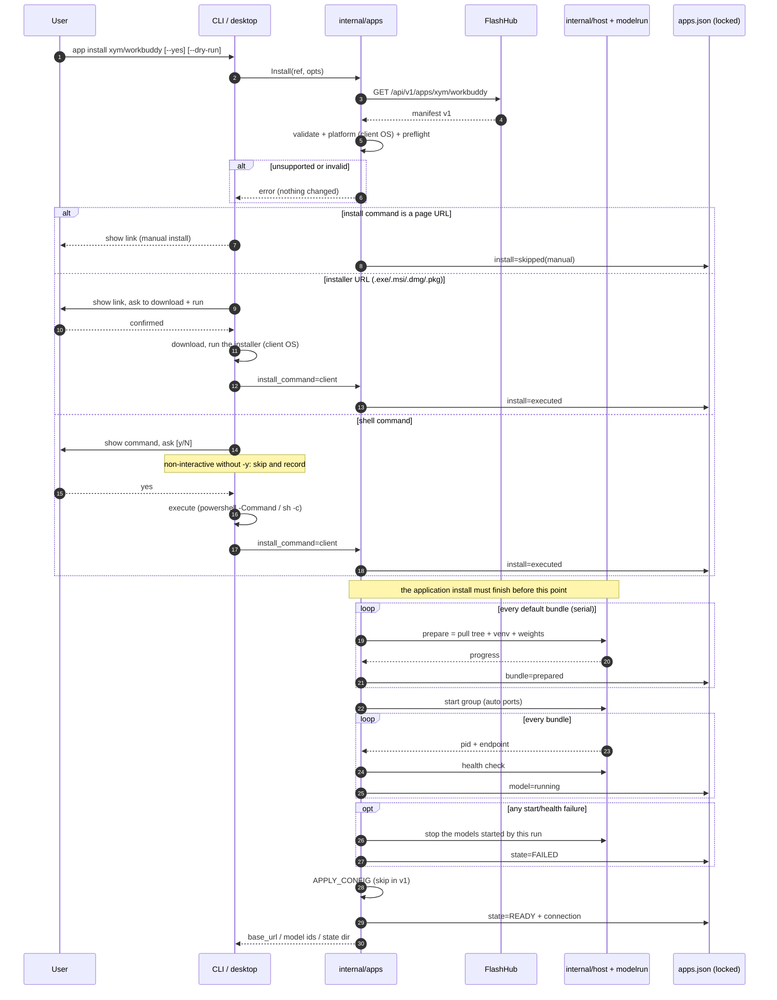
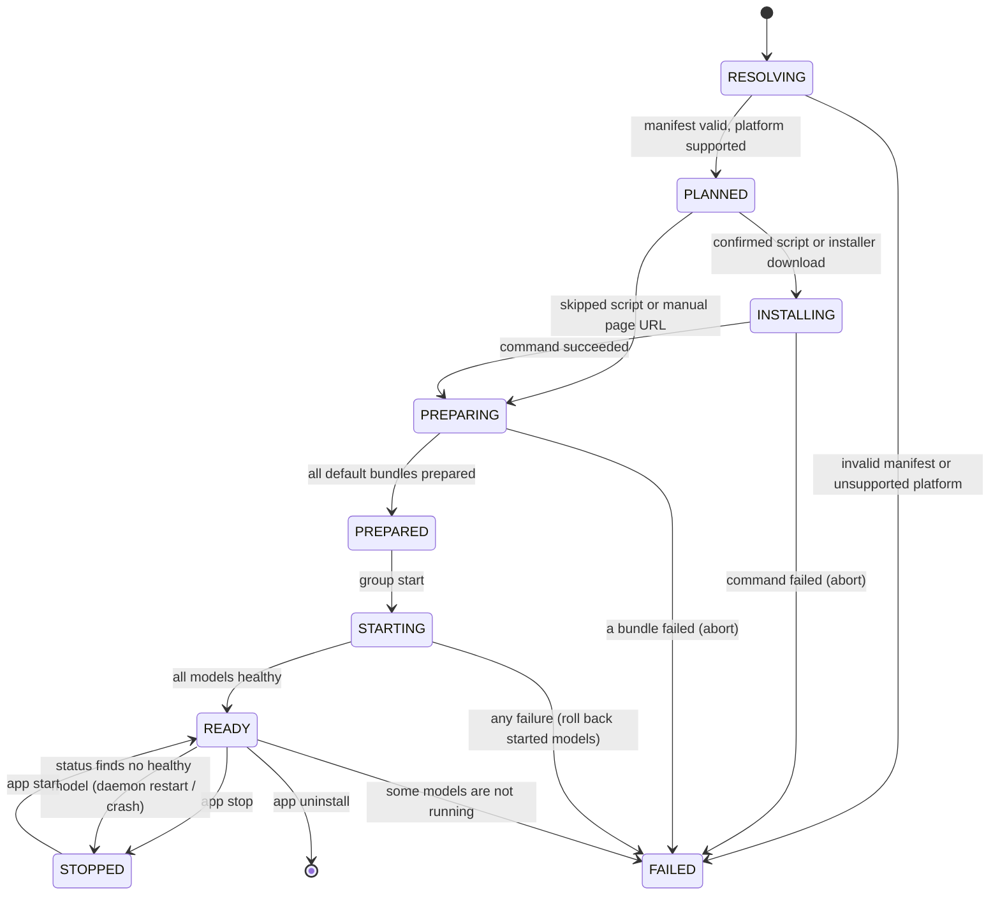

# FlashHub application install plan

<p align="right"><strong>English</strong> · <a href="application_install_plan.zh-CN.md">简体中文</a></p>

> **Status: implemented (v1).** The manifest schema is specified in
> [app_manifest_standard.md](app_manifest_standard.md) (v1, matching FlashHub).

## Goals

One command installs an application, prepares its models, and leaves them ready:

```bash
flashcli app install xym/workbuddy
```

`flashcli` must work **without** a running `flashserver`; the daemon and the CLI
share one Go implementation (`internal/apps`), and the desktop talks to the
daemon over HTTP only.

## Terminology

| Term | Meaning |
|---|---|
| **Application** | An external app published on FlashHub (`xym/workbuddy`) |
| **App key** | `[namespace/]name[:version]` |
| **Manifest** | `flashcli-application` document (see the manifest standard) |
| **Model bundle** | Existing `flashcli-bundle/<name>:<version>` runtime |
| **Resident daemon** | `flashserver` (unchanged: scheduler, console, API) |

## Responsibilities

| Component | Owns |
|---|---|
| FlashHub | App registry, versions, manifest validation, metadata |
| `internal/apps` (shared) | Manifest use, install policy, app state, model preparation and lifecycle |
| `internal/modelrun` (shared) | Supervising `flashcli serve` children (ports, health, logs, stop) |
| `flashcli` CLI | User interaction, confirmations, exit codes, JSON output |
| `flashserver` | HTTP API used by the desktop; calls the same shared package |
| `flashcli-desktop` | UI only; HTTP/WS to `flashserver` |

No HTTP call from the CLI to the daemon is required (or used) for app operations.

## App key

`xym/workbuddy` resolves the latest version; `xym/workbuddy:1.0.0` pins it.
`flashcli app install` records the resolved version.

## Manifest

`GET /api/v1/apps/{namespace}/{name}[:version]` returns the manifest. The host
validates `format`, `app_format_version`, `protocol_version`, required fields,
and that `name`/`version` match the key. See
[app_manifest_standard.md](app_manifest_standard.md).

## Install flow

Steps (all state transitions are persisted so `status` and re-runs work). The
order is fixed: **the application is installed first; no bundle is prepared
until that step succeeded** (or the user explicitly skipped it).

```text
RESOLVE → VALIDATE → PLATFORM → PREFLIGHT → PLAN
  → CONFIRM_INSTALL (shell command or installer download; page URL: manual)
  → INSTALL_APP (script: run | installer URL: download + run | page: open/copy)
  → PREPARE_MODELS (every default bundle, serial)
  → START_MODELS (one group, auto ports)
  → HEALTH (per model)
  → APPLY_CONFIG (skipped in v1)
  → READY
```



### State machine



`status` reconciles the stored state with live health: a `ready` app whose
model process is gone is reported as `stopped` (so 启动 is enabled and the dead
endpoint is not advertised), and the connection URL is recomputed after every
start because the scheduler picks the port. Start/stop are also available as
async jobs (`?async=1`) so clients can stream their progress lines instead of
showing a silent spinner while a model loads.

### Setup scripts (optional)

After the models become ready, the host runs the manifest's `setup.scripts` in
manifest order for the keys the user confirmed **for this run**. The client (the
desktop dialog on every start/install, or the CLI prompt per script) is the
confirmation point. Each script is downloaded, verified against `sha256`, and
executed with the explicit argv template (`{base_url}`, `{model}`, `{api_key}`).
A failure is written to the app job log and stops the remaining scripts; the
running app is not marked failed. Apps without `setup.scripts` skip this step.
The confirmed keys and client home are persisted; after a daemon restart the
restored app automatically runs the same scripts
automatically once its models are ready, so the new connection is written
without another prompt.

### Failure and rollback

- **Script failure** aborts immediately; no model preparation runs.
- **Prepare failure** aborts; already prepared bundles stay cached (re-run resumes).
- **Start/health failure** stops the models started by that run
  (`--keep-partial` keeps them for debugging).
- Re-running `app install` is idempotent: it fills missing steps, reuses running
  models, and only re-runs the install script with `--force`.

## Commands

```bash
flashcli app list   [--json]
flashcli app show   <key> [--json]
flashcli app install <key> [--yes|-y] [--dry-run] [--force]
                     [--bundle REF]... [--no-install] [--no-model] [--no-start]
                     [--keep-partial]
flashcli app status <key> [--json]
flashcli app start|stop|restart <key>
flashcli app logs   <key> [--ref REF] [--lines N] [-f]
flashcli app uninstall <key> [--yes] [--purge-models]
```

Rules:

- Any shell execution requires explicit confirmation; `--yes` runs it without a
  prompt; non-interactive runs without `--yes` skip it and record `skipped`.
- URLs are handled by the client: the CLI prints the link and never downloads;
  the desktop, after confirmation, downloads and runs installers
  (.exe/.msi on Windows, .dmg/.pkg on macOS) and opens plain pages in a browser.
- Bundles are prepared only after the application install succeeded; a failed
  install (script or installer) aborts the whole run.
- Installs are serialized: one application at a time. `internal/apps` holds a
  process-wide install lock, and the desktop disables the other apps while an
  install job runs (its card and the page banner show the progress).
- Ports are allocated automatically and recorded; `start` is idempotent.
- `uninstall` stops the app's models and removes its state; model caches are kept
  unless `--purge-models` is given.

## Entry points

The CLI, the daemon and the desktop all drive the same `internal/apps` service;
only the way the install-script decision is obtained differs:

| Entry point | Install-script decision |
|---|---|
| `flashcli app install` | asks `[y/N]` on a terminal; `--yes` runs it; no terminal without `--yes` skips and records `skipped` |
| `flashserver` `POST /v1/apps/{org}/{name}/install` | body must carry `install_command: "run" \| "skip" \| "client"` (400 otherwise); runs as job `app-install` and streams events |
| `flashcli-desktop` 应用页 | 安装 dialog shows the command; 运行脚本并安装 runs it **on the client OS** and then sends `client`, 跳过脚本安装 sends `skip`, 取消 does nothing; job progress is polled into the detail pane |

### Platform ownership

The application and its models live on different platforms: the app is
installed where the user works (for example a Windows exe), while the models
run in WSL/the daemon host. Therefore:

- The manifest platform check and command selection use the **client** platform
  (`client_os`/`client_arch` on the API, the desktop's own OS/arch). Without
  them the daemon falls back to its own platform (CLI behaviour).
- The desktop executes the install command itself (`powershell -Command` on
  Windows, `sh -c` elsewhere) and reports `install_command: "client"`; the
  daemon records the command as executed and never runs a client-side exe.
- Preparing bundles and starting models stays with the daemon and is unaffected
  by the client platform.

Uninstall is exposed on both fronts (`DELETE /v1/apps/{org}/{name}`,
desktop 卸载 with an optional `purge_models`); it never removes the app's own
installed files.

## Local state

Shared by the CLI and the daemon at `$FLASHCLI_HOME/flashserver/apps.json`
(cross-process file lock; atomic rename on write):

```json
{
  "apps": {
    "xym/workbuddy": {
      "version": "1.0.0",
      "state": "ready",
      "installed_at": "2026-11-17T08:00:00Z",
      "install": {"command": "irm … | iex", "executed": true},
      "models": [
        {"ref": "xym/gemma4_e2b_it:1.0.1", "id": "gemma4_e2b_it",
         "port": 18100, "endpoint": "http://127.0.0.1:18100"}
      ],
      "connection": {"base_url": "http://127.0.0.1:18100/v1", "api_key": "local"}
    }
  }
}
```

## Model lifecycle

- `internal/apps` prepares bundles via `internal/host` and starts them via
  `internal/modelrun` (the same supervisor `flashserver` uses).
- Preparing is offline-first: a complete weights cache + download manifest is
  reused without contacting the model hub. Only an explicit `flashcli pull` and
  the desktop's 下载 force a remote re-listing.
- If `flashserver` is running, its `Manager` and `apps` share state: app models
  start through the Manager (same `max_loaded` slots and bundle
  `resources.min_vram_mib` admission as the 模型 page), and `start` reuses the
  recorded pid/port when the model is already resident.
- Applications that declare the same bundle share one resident instance. Each
  application is an owner (the 模型 page is the `model` owner), including when it
  reuses an already healthy instance; stopping an app releases only its own
  claim, and the process stops when the last owner releases it. Unloading from
  the 模型 page is the explicit override that stops it regardless of owners.
- Stopping or uninstalling an app releases its models through the Manager, so
  the slots and the 模型 page list stay accurate even though the daemon builds a
  short-lived app service per request.
- Auto ports are recorded; on restart the recorded port is reused when free.
- On daemon start, apps that were ready with live models are started again
  (models loaded from the 模型 page are restored from
  `~/.flashcli/flashserver/models.json`). This runs in the background through
  normal admission; the OS autostart toggle only decides whether the daemon
  starts at boot.

## Configuration

v1 manifests publish `config: []`; the host does not interpret it. Client
configuration is done by `setup.scripts` (see
[app_manifest_standard.md](app_manifest_standard.md)): after the models are
ready, the confirmed scripts write the application's own config using the
connection. There is no `connection.json` writer.

## Security

- Remote shell installers are shown first and require confirmation; `--yes` is
  the only way to run them unattended.
- URLs are never fetched by the daemon. The desktop downloads an installer only
  after the user confirms it in the dialog (the host is shown), and page links
  open in the browser.
- The local API stays single-user (no remote mode).
- The desktop never guesses about an install script or installer. 安装 opens a
  dialog that shows the command or URL; a script runs and an installer downloads
  only after 运行脚本并安装 / 下载并安装 (跳过 prepares the models without it). The
  daemon enforces this: `POST /v1/apps/{org}/{name}/install` requires
  `install_command: "run" | "skip" | "client"` and rejects a missing value, since
  a daemon has no terminal to ask.

## Testing

| Tier | Coverage |
|---|---|
| T1 | manifest parse/validate, platform command precedence, default bundle selection, state lock/round-trip, shared lifecycle with fakes, install endpoint run/skip/decision-required; desktop helper unit tests (request body decision, URL vs script, log dedupe/cap) |
| T2 | local fake FlashHub (httptest) + real `flashserver`: prepare → start → status → stop; the install job with `install_command: run` (script output recorded), `skip` (no script), and no decision (400); `--dry-run`; shell prompt/decline; URL is never executed |
| T3 | `FLASHCLI_FLASHHUB_LIVE=1`: live app list/manifest shape contract |

## Milestones

1. **M1** — extract `internal/modelrun` from the server launcher; `server` uses it (existing tests stay green).
2. **M2** — `internal/apps`: manifest, install policy, locked registry, `Prepare`.
3. **M3** — `internal/apps`: `Start`/`Stop`/`Status`/`Uninstall` with auto ports and rollback.
4. **M4** — `flashcli app` commands calling `internal/apps` directly.
5. **M5** — `flashserver` `/v1/apps*` handlers (thin) and the desktop 应用 page.
6. **M6** — docs, OpenAPI, T1/T2/T3, release gate.
