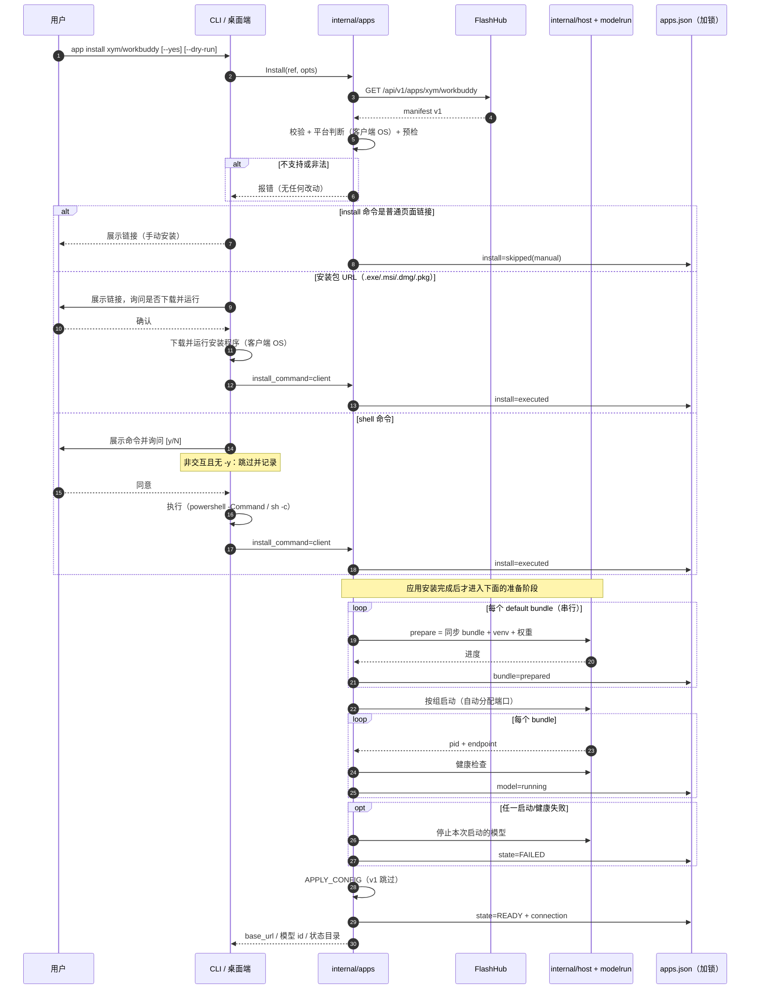
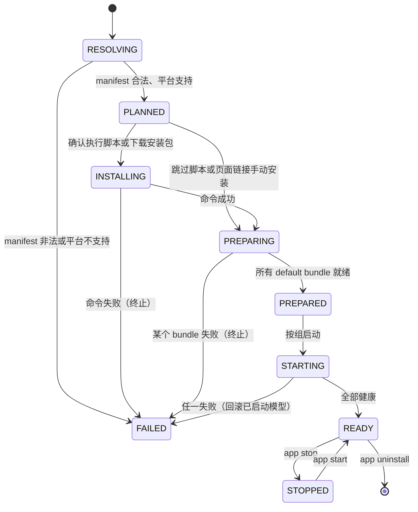

# FlashHub 应用安装计划

<p align="right"><a href="application_install_plan.md">English</a> · <strong>简体中文</strong></p>

> **状态：已实现（v1）。** manifest 规范见
> [app_manifest_standard.zh-CN.md](app_manifest_standard.zh-CN.md)（v1，与 FlashHub 实际一致）。

## 目标

一条命令完成应用安装、模型准备并保持可用：

```bash
flashcli app install xym/workbuddy
```

`flashcli` 必须能在**没有** `flashserver` 运行时独立工作；守护进程与 CLI 共用同一套
Go 实现（`internal/apps`），桌面只通过 HTTP 访问守护进程。

## 术语

| 术语 | 含义 |
|---|---|
| **Application** | FlashHub 上发布的外部应用（如 `xym/workbuddy`） |
| **App key** | `[namespace/]name[:version]` |
| **Manifest** | `flashcli-application` 文档（见规范） |
| **Model bundle** | 现有 `flashcli-bundle/<name>:<version>` 运行时 |
| **常驻守护进程** | `flashserver`（调度器、控制台、API，保持不变） |

## 职责

| 组件 | 负责 |
|---|---|
| FlashHub | 应用注册、版本、manifest 校验、元数据 |
| `internal/apps`（共享） | manifest 使用、安装策略、应用状态、模型准备与生命周期 |
| `internal/modelrun`（共享） | 监管 `flashcli serve` 子进程（端口、健康、日志、停止） |
| `flashcli` CLI | 用户交互、确认、退出码、JSON 输出 |
| `flashserver` | 供桌面使用的 HTTP API；调用同一共享包 |
| `flashcli-desktop` | 仅 UI；HTTP/WS 访问 `flashserver` |

CLI 的应用操作**不需要**（也不使用）对守护进程的 HTTP 调用。

## App key

`xym/workbuddy` 解析最新版本；`xym/workbuddy:1.0.0` 固定版本。
`flashcli app install` 会记录解析出的版本。

## Manifest

`GET /api/v1/apps/{namespace}/{name}[:version]` 返回 manifest。host 校验
`format`、`app_format_version`、`protocol_version`、必填字段，以及 `name`/`version`
与 key 一致。详见 [app_manifest_standard.zh-CN.md](app_manifest_standard.zh-CN.md)。

## 安装流程

每一步都持久化状态，便于 `status` 观察与失败后重入：

```text
RESOLVE → VALIDATE → PLATFORM → PREFLIGHT → PLAN
  → CONFIRM_INSTALL（shell 命令或安装包下载；普通页面链接：手动）
  → INSTALL_APP（脚本：执行 | 安装包 URL：下载并运行 | 页面：打开/复制）
  → PREPARE_MODELS（所有 default bundle，串行）
  → START_MODELS（作为一组，自动端口）
  → HEALTH（逐个模型）
  → APPLY_CONFIG（v1 跳过）
  → READY
```

顺序是固定的：**先装应用，安装成功之前不会开始准备任何 bundle**（除非用户明确跳过）。



### 状态机



### 失败与回滚

- **脚本失败**立即终止，不再准备模型
- **准备失败**终止；已准备的 bundle 保留缓存，重跑可续
- **启动/健康失败**停止本次已启动的模型（`--keep-partial` 保留用于排查）
- 重复执行 `app install` 幂等：补齐缺失步骤、复用运行中的模型；只有 `--force`
  才会重跑安装脚本

## 命令

```bash
flashcli app list   [--json]
flashcli app show   <key> [--json]
flashcli app install <key> [--yes|-y] [--dry-run] [--force]
                     [--bundle REF]... [--no-install] [--no-model] [--no-start]
                     [--keep-partial]
flashcli app status <key> [--json]
flashcli app start|stop|restart <key>
flashcli app logs   <key> [--ref REF] [--lines N] [-f]
flashcli app uninstall <key> [--yes] [--purge-models]
```

规则：

- 任何 shell 执行都要显式确认；`--yes` 免询问；非交互无 `--yes` 时跳过并记 `skipped`
- URL 由客户端处理：CLI 只打印链接（不下载）；桌面端在用户确认后下载并运行安装包
  （.exe/.msi → Windows，.dmg/.pkg → macOS），普通页面链接在浏览器打开
- 应用安装成功后才准备 bundle；安装失败会中止整个流程
- 同一时间只安装一个应用：`internal/apps` 持有进程级安装锁，桌面端在安装进行中禁用其他应用，
  并在卡片与页面顶部显示该应用的安装进度
- 端口自动分配并记录；`start` 幂等
- `uninstall` 停止该应用模型并移除状态；默认保留模型缓存（`--purge-models` 才清理）

## 入口

CLI、守护进程、桌面端都调用同一个 `internal/apps`，区别只在于「是否执行安装脚本」
这个决定怎么拿到：

| 入口 | 安装脚本决策 |
|---|---|
| `flashcli app install` | 终端上询问 `[y/N]`；`--yes` 直接执行；没有终端且无 `--yes` 时跳过并记录 `skipped` |
| `flashserver` `POST /v1/apps/{org}/{name}/install` | 必须带 `install_command: "run" \| "skip" \| "client"`（否则 400）；作为 `app-install` 作业执行并推送事件 |
| `flashcli-desktop` 应用页 | 「安装」弹窗展示命令：「运行脚本并安装」在**客户端 OS 本地**执行后发 `client`；「跳过脚本安装」发 `skip`；取消则什么也不做；作业进度轮询显示在详情区 |

### 平台归属

应用本体和模型不在同一个平台：应用装在用户实际使用的系统（例如 Windows 的
exe），模型跑在 WSL/守护进程所在主机。因此：

- manifest 的平台校验与命令选择使用**客户端**平台（API 的 `client_os`/`client_arch`，
  桌面端传自己的 OS/arch）；不传时守护进程回退到自身平台（CLI 行为）。
- 安装命令由桌面端自己执行（Windows 用 `powershell -Command`，其他系统用 `sh -c`），
  然后告诉守护进程 `install_command: "client"`；守护进程只记录「已执行」，绝不在
  WSL 里跑客户端 exe。
- 准备 bundle、启动模型仍由守护进程负责，与客户端平台无关。

卸载在三端都可用（`DELETE /v1/apps/{org}/{name}`；桌面「卸载」可选 `purge_models`），
但都不会卸载应用自身安装的文件。

## 本地状态

CLI 与守护进程共享 `$FLASHCLI_HOME/flashserver/apps.json`（跨进程文件锁；写入原子
rename）：

```json
{
  "apps": {
    "xym/workbuddy": {
      "version": "1.0.0",
      "state": "ready",
      "installed_at": "2026-11-17T08:00:00Z",
      "install": {"command": "irm … | iex", "executed": true},
      "models": [
        {"ref": "xym/gemma4_e2b_it:1.0.1", "id": "gemma4_e2b_it",
         "port": 18100, "endpoint": "http://127.0.0.1:18100"}
      ],
      "connection": {"base_url": "http://127.0.0.1:18100/v1", "api_key": "local"}
    }
  }
}
```

## 模型生命周期

- `internal/apps` 通过 `internal/host` 准备 bundle，通过 `internal/modelrun` 启动
  （与 `flashserver` 使用同一个监管器）
- 准备是离线优先的：权重缓存与下载清单完整时直接复用，不访问模型 Hub；只有显式
  `flashcli pull` 和桌面端「下载」会强制重新列取远端文件
- `flashserver` 在运行时，其 `Manager` 与 `apps` 共享状态：`start` 发现记录中的
  pid/端口存活则复用，不重复拉起
- 自动端口会记录；重启时优先复用，被占用才重新分配

## 配置（待定）

v1 的 manifest 发布 `config: []`。host 只写 `connection.json`（base URL、模型 id、
`api_key=local`），不修改应用文件。后续 `config` schema 会定义适配器
（`json`/`yaml`/`env`/…）并带备份与回滚。

## 安全

- 远程 shell 安装器先展示再确认；`--yes` 是唯一的免交互方式
- URL 不由守护进程抓取：桌面端只在用户于弹窗确认后下载并运行安装包（弹窗显示来源），
  普通页面链接在浏览器打开
- 本地 API 保持单用户（不做 remote 模式）
- 桌面端从不自行决定是否执行安装脚本/安装包：点「安装」先展示命令，只有选
  「运行脚本并安装」/「下载并安装」才执行（选「跳过」则只准备模型）。守护进程强制这一点：
  `POST /v1/apps/{org}/{name}/install` 必须带 `install_command: "run" | "skip"`，
  缺失即拒绝——daemon 没有终端可以询问用户

## 测试

| 级别 | 覆盖 |
|---|---|
| T1 | manifest 解析/校验、平台命令优先级、default bundle 选择、状态锁/读写、共享生命周期的 fake 测试、安装接口的 run/skip/缺少决策；桌面纯函数单测（请求体决策、URL 与脚本区分、日志去重/上限） |
| T2 | 本地假 FlashHub（httptest）+ 真 `flashserver`：prepare → start → status → stop；安装作业的 `install_command: run`（记录脚本输出）、`skip`（不执行脚本）、缺少决策（400）；`--dry-run`；终端确认/拒绝；URL 不执行 |
| T3 | `FLASHCLI_FLASHHUB_LIVE=1`：线上应用列表/manifest 形状契约 |

## 里程碑

1. **M1** —— 从 server 抽取 `internal/modelrun`；`server` 改用它（现有测试保持全绿）
2. **M2** —— `internal/apps`：manifest、安装策略、加锁注册表、`Prepare`
3. **M3** —— `internal/apps`：`Start`/`Stop`/`Status`/`Uninstall`（自动端口 + 回滚）
4. **M4** —— `flashcli app` 命令组（直接调用 `internal/apps`）
5. **M5** —— `flashserver` `/v1/apps*`（薄封装）与桌面「应用」页（左侧菜单）
6. **M6** —— 文档、OpenAPI、T1/T2/T3、发布门禁
