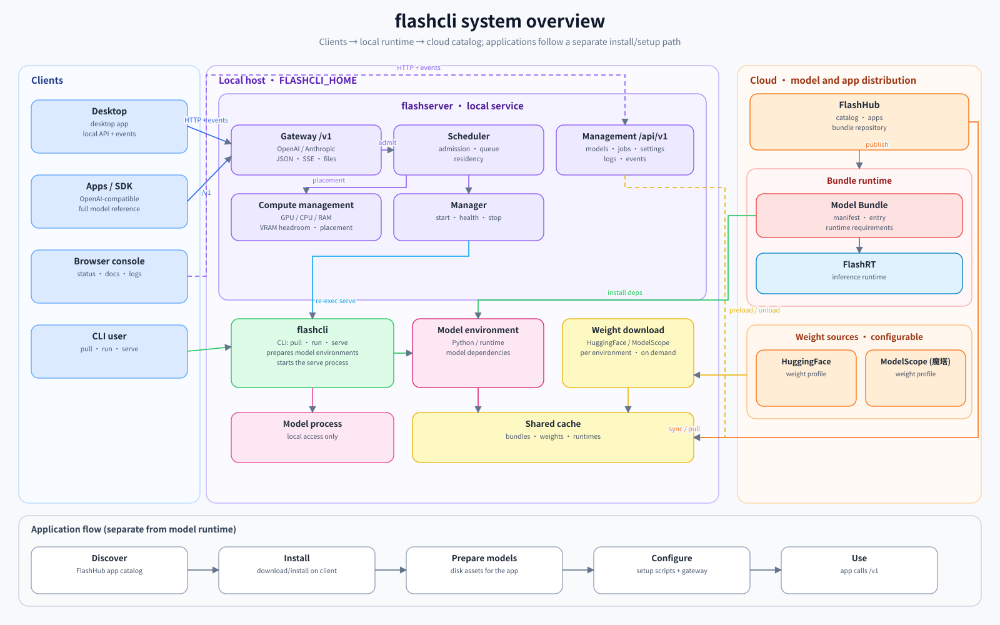
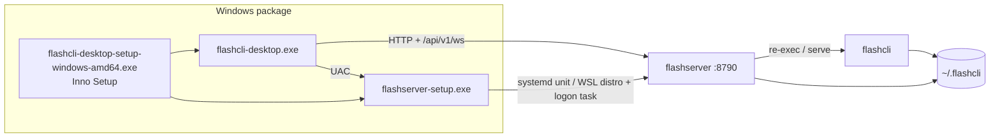
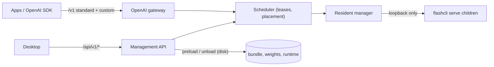
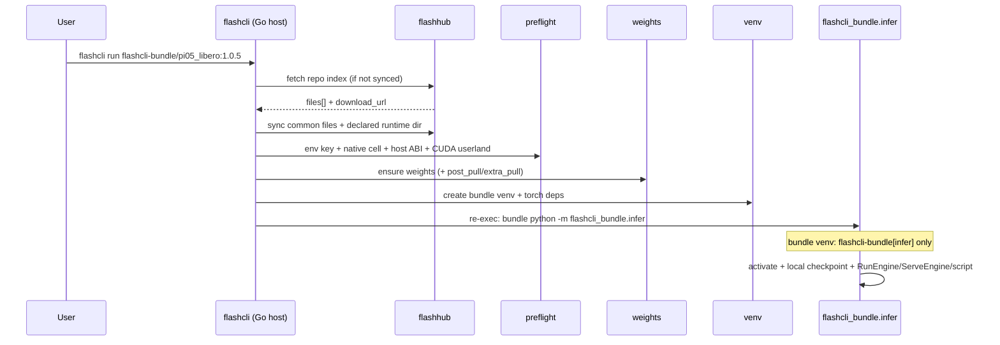

# Architecture

<p align="right"><strong>English</strong> · <a href="architecture.zh-CN.md">简体中文</a></p>

flashcli is the **distribution and runtime host** for FlashRT: it resolves presets, fetches Model Bundles from FlashHub, preflights the host GPU environment, creates a bundle venv, caches weights, and calls `RunEngine` / `ServeEngine` from each bundle’s **`entry`**.

It does **not** implement model forward passes or CUDA kernels; those live in bundle modules such as `run.py` (and optional `flash_rt/` / `.so` files). A **native-only** bundle may instead drive a native model-runtime ABI with no Python entry (`entry.kind = native-abi|native-exec`; see [bundle_execution_abi.md](bundle_execution_abi.md)).

> **Go host.** The host CLI is a static Go binary under `go/` (module `github.com/aodianyun/flashcli/go`); the Python host was removed. `flashcli-bundle/` remains: it is the **protocol** + **infer** package installed into bundle venvs (`flashcli-bundle[infer]`). Execution backends (`entry.kind`) are specified in [bundle_execution_abi.md](bundle_execution_abi.md).

## Diagrams



The system overview is intentionally coarse. The other diagrams are **step-level**: inputs, decisions, branches, state transitions, error/retry paths, and the component each step touches. Style rules: [CONTRIBUTING.md → Architecture and flow diagrams](../CONTRIBUTING.md#architecture-and-flow-diagrams).

| Diagram | Contents |
|---|---|
| [System overview](images/architecture-overview.en.svg) · [PNG](images/architecture-overview.en.png) | Clients (Desktop, installed apps, CLI), flashserver modules (gateway, scheduler, manager, management, apps, system/GPU), flashcli execution, Model Bundle + FlashRT, shared cache, FlashHub, weight sources |
| [flashcli run/serve flow](images/flashcli-flow.en.svg) · [PNG](images/flashcli-flow.en.png) | Ref resolution, offline cache, preflight, venv, weights, entry, run/serve |
| [flashserver gateway/scheduler flow](images/flashserver-gateway-flow.en.svg) · [PNG](images/flashserver-gateway-flow.en.png) | `/v1` request path, `/api/v1` management, custom-path passthrough, preload, placement, lease, proxy, release, errors |
| [Model Bundle / FlashRT stack](images/bundle-runtime-stack.en.svg) · [PNG](images/bundle-runtime-stack.en.png) | FlashHub → bundle manifest/entry/runtime cells → venv/weights → FlashRT |
| [Go host module map](images/go-module-map.en.svg) · [PNG](images/go-module-map.en.png) | Commands → CLI/server frontends → shared host services → execution backends |
| [FlashHub flow](images/flashhub-flow.en.svg) · [PNG](images/flashhub-flow.en.png) | Publish → catalog/versions → CLI/flashserver/desktop sync |
| [App lifecycle](images/app-lifecycle.en.svg) · [PNG](images/app-lifecycle.en.png) | install → prepare → setup → ready; no app-owned model start/stop |

All diagrams in [`images/`](images/) are hand-laid SVG. The SVG is authoritative; render PNGs with `rsvg-convert -w 1600 -h 900 -o <name>.<lang>.png <name>.<lang>.svg`. Style requirements: [CONTRIBUTING.md → Architecture and flow diagrams](../CONTRIBUTING.md#architecture-and-flow-diagrams).

## Core principles

1. **Inference lives in the bundle** — the bundle owns **all model-specific logic**: the forward pass, preprocessing/postprocessing, modality shapes and dtypes, input/output semantics, and option→port mapping/defaults. flashcli is a **generic, model-agnostic driver**: it resolves the ref, prepares the environment, and invokes the bundle-provided interface — `entry` for `kind=python`, or the declared model-runtime ABI + manifest `native` block for `native-exec`/`native-abi`. **No model-specific constants, shapes, or preprocessing may live in the host** (`go/`).
2. **Preset ref** — users pass `namespace/bundle:version`; `FLASHCLI_FLASHHUB_API` sets the API base.
3. **Manifest-first + split download** — fetch manifest → preflight against `environments` → download common files plus only the selected environment's declared runtime directory.
4. **Fixed Python ABI** — one venv per bundle (`python_abi`); CLI **re-execs** into that venv after prepare.
5. **Single Go host** — the host is a static Go binary; bundle venvs pip-install **`flashcli-bundle[infer]`** (never a host `flashcli` package).
6. **One command** — `flashcli run <ref>` chains sync → deps → weights (host download if missing) → `post_pull` → offline inference in bundle venv.
7. **One host cache layer** — `go/internal/host` is the single implementation of cache discovery, weights key/readiness, runtime IDs/paths, disk accounting, ref-path resolution, and cleanup. `flashcli` and `flashserver` are frontends: they parse input, call `host`, and format/transport results. They must not reimplement these checks.

### Where modules live (required reading)

**Host-only → `go/internal/`. Infer-only → `flashcli_bundle/infer/`. Both → `flashcli_bundle/` protocol.** Re-export is not an excuse to put single-layer logic in protocol. See [module_layers.md](module_layers.md).

## Host CLI vs bundle infer (important)

`flashcli pull` / `bundle sync` / weight download run in the **Go host**.  
`flashcli run` / `serve` prepare the bundle, then either **re-exec** into the **bundle venv** (`python -m flashcli_bundle.infer`) for `entry.kind: python`, or drive a **native** backend for `native-exec` / `native-abi`.

| What | Where it lives | Installed how |
|------|----------------|---------------|
| `flashcli` CLI (pull, sync, doctor) | Go binary on PATH (`go/`) | `install.sh` |
| **`flashcli-bundle`** (protocol) | Host (build/dev) | `flashcli-bundle/` source |
| **`flashcli-bundle[infer]`** | Bundle venv only | `venv.Ensure` → pip (`FLASHCLI_BUNDLE_PIP_SPEC` / repo / local checkout) |
| Bundle inference stack (torch, transformers, …) | `~/.flashcli/runtimes/<id>/venv/` | From `flashcli-bundle.json` → `python_dependencies` |
| Bundle venv infer entrypoint | Same bundle venv | `python -m flashcli_bundle.infer` — **no** host package |

**Dependency isolation:** the host never installs into the bundle venv except `flashcli-bundle[infer]` and manifest `python_dependencies`. Weight download runs on the **host** only; the bundle infer subprocess resolves cached or bundle-local paths only (`HF_HUB_OFFLINE=1`).

## Shared host services (CLI + flashserver)

`flashcli` (CLI) and `flashserver` (resident daemon) are two frontends over the same on-disk state. **Any behavior needed by both MUST be implemented once in a shared package and called from both**; a second implementation in `go/internal/cli` or `go/internal/server` is a defect, even if the two copies agree today.

| Capability | Shared API | CLI use | flashserver use |
|------------|------------|---------|-----------------|
| Pull / runtime + venv preparation / weights | `host.Pull`, `host.EnsureRuntime`, `host.ResolveWeights` | `flashcli pull`, `run`/`serve` | `/api/v1/models/preload`, app prepare, Manager |
| Serve log name / tail / readiness | `modelrun.LogName`, `modelrun.TailLines`, `modelrun.WaitHealthy` | serve child, `app logs` | `/api/v1/logs`, Manager/scheduler |
| App install/setup/state | `apps.Service` | `flashcli app ...` | `/api/v1/apps`, gateway setup |
| Cache areas + unique allocated bytes | `host.Storage()` | `flashcli du` | `GET /api/v1/storage` |
| Cached models, sizes, readiness, runtime bytes | `host.ListModels()` | `flashcli models list` | `GET /api/v1/models` |
| Bundle usability / serve capability | `host.BundleRootUsable`, `host.ListModels` | `models list/show` | `/api/v1/models` |
| Weights key + readiness | `host.MarkerWeightsKey`, `host.WeightsInfo`, `host.WeightsCachedForMarker` | `models list/show` | `/api/v1/models` |
| Canonical ref/cache key | `host.RefCacheKey` | ref resolution | cleanup/API refs |
| Cleanup path selection + removal | `host.RefPaths`, `host.RuntimePaths`, `host.OrphanPaths`, `host.AllDataPaths`, `host.SharedCachePaths`, `host.RemovePaths` | `flashcli bundle clean`, `flashcli cache clean` | `/api/v1/models/clean`, `/api/v1/storage/clean` |
| Remove model cache | `host.RemoveCachedRef` | `bundle clean` semantics | `/api/v1/models/clean` |
| GPU / system probes | `gpu.*`, `preflight.*`, `host.EnsureSystemRequirements` | run/serve, models | Manager admission, `/api/v1/system` |

Rules:

- **Do not** add another marker walker, weights-readiness check, directory-size walker, cleanup path resolver, pull orchestration, log-name sanitizer/tailer, readiness loop, or app-state predicate under `go/internal/cli` or `go/internal/server`.
- Add the behavior once in the shared package, then expose it through both frontends. Presentation-only helpers (tables, colors, prompts) stay in the frontend.
- **Pull/prepare is one pipeline:** `host.Pull` is used by `flashcli pull`, `/api/v1/models/preload` and app preparation; `host.EnsureRuntime` is the runtime/venv preparation used by pull, and must stay aligned with `flashcli serve` (system requirements, protocol cache schema, CUDA).
- **Serve children** use `modelrun.LogName`/`modelrun.TailLines` for log file naming/tailing and `modelrun.WaitHealthy` for readiness. Serve logs live under the canonical `~/.flashcli/logs/serve` (config `log_dir` overrides); both `flashcli app logs` and `/api/v1/logs` read the same name.
- **App state predicates** (running/restore) live in `apps` (`apps.WasRunning`); the daemon restore and the desktop must not re-derive them.
- **Isolation:** the daemon may wrap a shared service with a Launcher/Stopper (for example owner-aware Manager admission), but the lifecycle logic itself stays in `apps`; the CLI must not grow a parallel copy.
- **Scope — only genuinely common behavior is shared.** Do **not** force frontend-specific behavior into a shared package or make one frontend emulate the other. Keep the following in the respective frontend:
  - CLI: flags, prompts, human-readable tables/colors, single-process launch behavior.
  - flashserver: HTTP/auth/jobs/websocket, Manager slot/VRAM/owner admission, restore scheduling, telemetry/GPU history.
  - desktop: all UI, dialogs and local app/installer execution.
  - Adapters (Launcher/Stopper/Log hooks) may differ between frontends.
- **Decision test:** share it only if both frontends must make the **same decision about the same on-disk state or model readiness** (cache key, weights readiness, pull/prepare steps, serve log name/readiness, app state). If it is orchestration, scheduling policy, UX, or presentation, keep it in the frontend.
- `flashcli cache clean` removes the shared cache group (`cache` + base Python + uv), matching `/api/v1/storage/clean {"targets":["cache"]}`. Model data/runtimes use `flashcli bundle clean` / `/api/v1/models/clean`; shared weights/runtime are reference-counted and kept. Disk accounting and ref-path selection are shared in `host`.
- **Guard:** `go test ./internal/architecture/...` fails on the mechanical re-introductions (direct `nvidia-smi`, log-name `NewReplacer`, `filepath.Walk*`, `.flashcli_download.incomplete`). Add a pattern there when a new class of duplication is found.
- Tests: `go test ./...`; host tests cover accounting/cleanup, CLI tests exercise `du`, `models list`, and `bundle clean` through the host functions. See [module_layers.md](module_layers.md).

**Protocol cache schema:** the venv fingerprint tracks only manifest `python_dependencies` — it does **not** track the `flashcli-bundle` git ref. When the on-disk cache layout changes (`flashcli_bundle.version.CACHE_SCHEMA_VERSION`), `venv.EnsureProtocolCacheSchema` upgrades `flashcli-bundle` in an existing venv **in place** (`pip install --upgrade --force-reinstall --no-deps`, from the same source) before re-exec, so old venvs keep matching the host's cache paths without a full rebuild (no torch/dependency reinstall).

## Local service stack (desktop, `flashserver`, `flashserver-setup`)

Three components ship together. None of them duplicates cache logic: they call
`flashcli` or the shared `host` functions described above.

| Component | Source | Role |
|-----------|--------|------|
| `flashserver` | `go/cmd/flashserver`, `go/internal/server` | Resident scheduler and local console: OpenAI gateway (`/v1`), management API (`/api/v1`), disk preload/unload, resident start/stop, GPU-aware admission, job queue, per-model serve logs, `GET /health`, `/docs`, `/openapi.yaml`; embeds the console UI (`go/internal/server/web`; `FLASHCLI_WEB_DIR` overrides it) |
| `flashserver-setup` | `go/cmd/flashserver-setup`, `go/internal/setup` | Installer backend: Linux writes `/etc/flashserver/config.json` + `flashserver.service`; Windows imports the `flashserver_ubuntu` WSL2 distro, enables systemd and mirrors, and creates the logon task + model firewall rule. Also `--start-service` / `--stop-service`, `--enable-autostart` / `--disable-autostart`, `--uninstall` (`--purge-*`), `--dry-run`, `--progress-file` for the UI |
| Desktop client | `desktop/` (Rust, egui/eframe) | Windows GUI: talks only to the daemon's HTTP API and `/api/v1/ws`, and starts/stops the service through `wsl.exe` / `systemctl`; it never reads cache internals |



`flashserver` never imports Python infer code: it prepares and serves models by
running `flashcli`, so both frontends share one cache implementation. Its state
lives under `$FLASHCLI_HOME/flashserver/` (`serve-options.json`, per-model serve
logs). The HTTP contract is [openapi.yaml](../go/internal/server/openapi.yaml); user-facing behavior is
[flashserver.md](flashserver.md).

### Data plane vs control plane

`flashserver` separates inference traffic from management traffic on one port:

- **Data plane `/v1/*`** — OpenAI-compatible gateway. Applications and the
  desktop send inference requests with a full bundle ref in `model`. The
  scheduler preloads missing assets, starts/stops residents internally, holds a
  lease per active request, and proxies JSON/SSE/multipart/WebSocket traffic to a
  loopback child. Child endpoints are never returned to clients.
- Standard routes are host-owned and capability-gated. Any other `/v1/*` path is
  a **bundle-owned custom route** (`register_routes`): the gateway selects the
  model from the body or `?model=`, strips that selector, and forwards the
  method, path, body, SSE, and binary response unchanged. Custom paths are not
  capability-gated; the bundle decides whether the route exists.
- **Control plane `/api/v1/*`** — management. Cache/model listings, disk
  preload/unload, jobs, applications, devices/scheduler telemetry, logs, and the
  management WebSocket.

Disk state (`absent → preloading → preloaded → unloading`) and resident state
(`stopped → starting → ready ⇄ busy → stopping`) are independent. Preload/unload
are disk operations; resident start/stop is scheduler-owned. Automatic eviction
only stops residents and never deletes assets. The authoritative contract is
[flashserver_gateway_scheduler_spec.md](flashserver_gateway_scheduler_spec.md)
(zh-CN mirror alongside).




**Re-exec command** (inside bundle venv):

```text
bundle_venv/bin/python -m flashcli_bundle.infer run|serve …
```

The bundle venv does **not** prepend host `PYTHONPATH`. Implementation: Go `internal/{inferexec,nativeexec,nativeabi}` + `flashcli_bundle.infer` in `flashcli-bundle[infer]`.

### Do not (common mistakes)

- **Do not** prepend host `PYTHONPATH` or import a host `flashcli` package in the bundle infer process.
- **Do not** assume `flashcli` is pip-installable — it is a Go binary; only `flashcli-bundle` is Python.

During `activate_bundle()`, `PYTHONPATH` prepends the **bundle root** so `entry` and `flash_rt` import correctly.

## Boundary with FlashRT

| Responsibility | flashcli | Model Bundle |
|----------------|----------|----------------|
| Preset ref / FlashHub | ✓ | |
| `flashcli-bundle.json` | | ✓ |
| FlashHub fetch / local `path` | ✓ | |
| bundle venv, PYTHONPATH, pip | ✓ | `python_dependencies` |
| OpenAI + Anthropic HTTP (`serve`) | ✓ | |
| `RunEngine` / `ServeEngine` | | ✓ |
| `flash_rt`, `*.so` | | ✓ |

flashcli does **not** pip-depend on `flash-rt`. `import flash_rt` is only valid after `activate_bundle()`.

## Data flow (`flashcli run flashcli-bundle/pi05_libero:1.0.5`)



**Entry modes**: `engine` (default) loads `RunEngine`/`ServeEngine` and parses manifest CLI options; `script` passes argv through to the bundle entry script; the host only uses `--checkpoint` for weight pull.

**Backends**: `entry.kind` selects `python` (re-exec, above), `native-exec` (host spawns), or `native-abi` (host `dlopen`s). See [bundle_execution_abi.md](bundle_execution_abi.md).

**Resolution order**: local positional path (directory with `flashcli-bundle.json`) > synced bundle cache (preset marker under `bundles/<cache-key>/`); FlashHub refs are synced via `bundle sync`.

**Runtime cell selection** (shared by `flashcli` and `flashserver`):

1. exact `environments` key for this host (`sm<sm>-cu<cuda>-<os>-<arch>-py<abi>`);
2. explicit `match` blocks on an environment (they may ignore the CUDA tag);
3. scored fallback (`preflight.ScoreEnvKeyMatch`) over cells that agree on
   SM/OS/arch/Python, preferring the same CUDA family.

The host key uses the **driver's** CUDA capability (`nvidia-smi`) before the
installed `nvcc`. A cell that requires a newer CUDA than the driver reports is
rejected instead of failing later at `dlopen`, and a cell for a different SM is
never selected.

## Weights cache: completeness vs readiness (offline guarantee)

Two independent checks, deliberately separated:

1. **Host — download completeness.** After listing the remote file set (and
   applying the bundle's `allow_patterns`), the host writes the **expected set**
   to `<weights_dir>/.flashcli_download.json` (`path`, `size`) **before**
   transferring files. A cache is complete only when every recorded file exists
   with its recorded size. The expected set is kept on failure, so the next
   attempt resumes missing/incomplete files. While a download is in progress or
   interrupted, `<weights_dir>/.flashcli_download.incomplete` is present.
   This is model-agnostic: it never encodes bundle-specific filenames. The main
   weights and every `extra_weights` destination have their own manifest.
2. **Bundle — readiness.** `flashcli-bundle.json` declares what the entry needs
   (`allow_patterns`, `require_any_patterns`, `require_norm_stats`); the host
   evaluates those rules only to decide whether the bundle is usable.

**Network policy — `run`/`serve` are local-first:**

- a **complete download manifest** → local verification + bundle readiness
  (no network);
- a manifest file that exists but cannot be parsed is **never** treated as
  complete; the host re-lists;
- when the manifest is missing or incomplete, `run`/`serve` auto-prepare
  (network) and resume the expected set; an explicit `flashcli pull` always
  re-lists the remote and rewrites the expected set, even when the local
  manifest is complete.

Therefore **once preparation succeeds** (bundle tree + weights + venv/deps),
every later `run`/`serve` runs **offline**. Network is only needed when artifacts
are missing, on an explicit `flashcli pull`, or when a protocol
`CACHE_SCHEMA_VERSION` change requires upgrading the venv's `flashcli-bundle`.

A manifest that exists but is **incomplete is never accepted**, even if the
lenient bundle readiness would otherwise pass; an interrupted download is
resumed from the recorded expected set.

## Bundle venv installer (uv)

Bundle venvs are created and installed with **uv** by default (per-model
isolation is kept). uv is **not shipped** with flashcli: `uv.Ensure` resolves
`FLASHCLI_UV_BIN` → `uv` on `PATH` → a previously provisioned copy, and otherwise
provisions a pinned/current uv from the configured PyPI index (CN mirror) with
sha256 verification into `~/.flashcli/tools/uv/<version>/`.

- Provisioning prefers the configured **PyPI index** (latest stable wheel,
  sha256-verified). If the index is unreachable it asks the **GitHub latest
  release**, then a pinned default, and downloads the **GitHub release** tarball
  (sha256-verified).
- `uv venv --python <base> --seed` creates the venv; `uv pip install --python …`
  installs `flashcli-bundle[infer]`, torch, and manifest deps. Protocol upgrades
  and CUDA userland installs go through the same installer.
- `UV_CACHE_DIR` defaults to `~/.flashcli/cache/uv` (same filesystem as
  `runtimes/`, so uv **hardlinks** shared wheels and the heavy torch/CUDA layer
  is stored once); `UV_LINK_MODE=hardlink`.
- `FLASHCLI_VENV_BACKEND=pip` is an explicit escape hatch (deprecated) for
  environments where uv cannot run; the default `uv` fails clearly if uv is
  unavailable. Native bundles do not need uv.
- After a venv is created it is offline-usable (uv is only needed when
  installing). `flashcli cache clean` removes only the shared cache
  (`~/.flashcli/cache`, base Python, uv tools) and does not touch existing
  venvs, bundles, or weights. `flashcli cache prune` prunes unreachable uv
  cache objects (conservative; `cache clean` fully clears the cache group).
- `flashcli bundle clean <ref>` removes only that ref's runtime; add `--all` to
  also remove its bundle tree and weights. Shared weights/runtime stay while
  another cached ref references them (the remaining bundle markers are the
  reference count). `flashcli bundle clean` removes all runtimes;
  `flashcli bundle clean --all` resets all runtimes, bundles, and models.
  Every mode prints the affected paths and asks `Continue? [y/N]`; `--yes`
  skips the prompt for scripts.
- `flashcli bundle clean --orphans` removes stale bundle/model cache entries
  whose preset marker `bundle_root` no longer exists, plus runtime dirs with no
  valid bundle root. Valid caches are untouched; use it after deleting a local
  bundle or a test cache.

## Local directories

```text
~/.flashcli/
├── install.env              # flashcli-bundle[infer] source: local checkout (source build) or repo/ref (release)
├── mirror.env               # written by install.sh --mirror (pip/HF/GitHub mirrors)
├── src/                     # --from-source checkout (build input; default ~/.flashcli/src)
├── python/                  # optional standalone Pythons for bundle venv base
├── python-runtime.env       # FLASHCLI_PY<abi>_BIN=… written when standalone Python is provisioned
├── runtimes/<id>/           # bundle venv + .runtime.json marker
├── bundles/<name>/<version>/.flashcli_bundle.json   # synced tree (shared by all environments)
├── cache/repo-index/        # FlashHub listing cache
├── cache/uv/                # uv package cache (default UV_CACHE_DIR)
├── tools/uv/<version>/      # provisioned uv binaries
└── models/store/<source>/<repo>@<revision>-<hash>/     # v4 shared weights store +
                                                       #   .flashcli_download.json / .flashcli_download.incomplete
```

## Bundle layout (after sync)

```text
{bundle_root}/
├── flashcli-bundle.json
├── run.py                       # may also live inside the runtime directory
├── flash_rt/                    # optional
└── <runtime-dir>/               # declared by environments.<key>.runtime
    └── *.so                     # loaded in place from the selected directory
```

> Native-only bundles omit `run.py` / `flash_rt/` and keep their C libraries under the selected runtime directory (for example `runtime/<runtime-dir>/substrate/`). Files outside all declared runtime directories are common and are downloaded for every environment.

See [model_bundle_standard.md](model_bundle_standard.md).

## Module map

See [module_layers.md](module_layers.md) for the authoritative host / infer / protocol package map and placement rules.

## Example refs

| Ref | capabilities |
|-----|--------------|
| `flashcli-bundle/pi05_libero:1.0.5` | `run` |
| `flashcli-bundle/groot_n16:1.0.1` | `run` |
| `flashcli-bundle/groot_n17:1.0.1` | `run` |
| `flashcli-bundle/qwen3_8b_nvfp4:1.0.0` | `run`, `serve` |
| `flashcli-bundle/qwen36_27b_nvfp4:1.0.0` | `run`, `serve` |
| `flashcli-bundle/qwen3_vl_8b_nvfp4:1.0.0` | `run`, `serve` |
| `flashcli-bundle/wan22:1.0.1` | `run` |
| `flashcli-bundle/higgs_audio:1.0.1` | `run` |
| `flashcli-bundle/pi05_libero_nexus:1.0.3` | `run`, `serve` |

## Related docs

- [module_layers.md](module_layers.md) — three-layer module ownership and import rules
- [model_bundle_standard.md](model_bundle_standard.md) — preset ref + runtime flow
- [bundle_publish_standard.md](bundle_publish_standard.md) — manifest and entry spec
- [bundle_execution_abi.md](bundle_execution_abi.md) — execution backends (`entry.kind`) and native contracts
