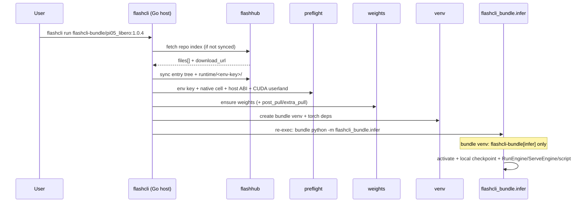

# Architecture

<p align="right"><strong>English</strong> · <a href="architecture.zh-CN.md">简体中文</a></p>

flashcli is the **distribution and runtime host** for FlashRT: it resolves presets, fetches Model Bundles from FlashHub, preflights the host GPU environment, creates a bundle venv, caches weights, and calls `RunEngine` / `ServeEngine` from each bundle’s **`entry`**.

It does **not** implement model forward passes or CUDA kernels; those live in bundle modules such as `run.py` (and optional `flash_rt/` / `.so` files). A **native-only** bundle may instead drive a native model-runtime ABI with no Python entry (`entry.kind = native-abi|native-exec`; see [bundle_execution_abi.md](bundle_execution_abi.md)).

> **Go host.** The host CLI is a static Go binary under `go/` (module `github.com/aodianyun/flashcli/go`); the Python host was removed. `flashcli-bundle/` remains: it is the **protocol** + **infer** package installed into bundle venvs (`flashcli-bundle[infer]`). Execution backends (`entry.kind`) are specified in [bundle_execution_abi.md](bundle_execution_abi.md).

## Core principles

1. **Inference lives in the bundle** — the bundle owns **all model-specific logic**: the forward pass, preprocessing/postprocessing, modality shapes and dtypes, input/output semantics, and option→port mapping/defaults. flashcli is a **generic, model-agnostic driver**: it resolves the ref, prepares the environment, and invokes the bundle-provided interface — `entry` for `kind=python`, or the declared model-runtime ABI + manifest `native` block for `native-exec`/`native-abi`. **No model-specific constants, shapes, or preprocessing may live in the host** (`go/`).
2. **Preset ref** — users pass `namespace/bundle:version[@variant]`; `FLASHCLI_FLASHHUB_API` sets the API base.
3. **Manifest-first + split download** — fetch manifest → preflight against `runtime` keys → download only this host’s `runtime/<env-key>/`.
4. **Fixed Python ABI** — one venv per bundle (`python_abi`); CLI **re-execs** into that venv after prepare.
5. **Single Go host** — the host is a static Go binary; bundle venvs pip-install **`flashcli-bundle[infer]`** (never a host `flashcli` package).
6. **One command** — `flashcli run <ref>` chains sync → deps → weights (host download if missing) → `post_pull` → offline inference in bundle venv.

### Where modules live (required reading)

**Host-only → `go/internal/`. Infer-only → `flashcli_bundle/infer/`. Both → `flashcli_bundle/` protocol.** Re-export is not an excuse to put single-layer logic in protocol. See [module_layers.md](module_layers.md).

## Host CLI vs bundle infer (important)

`flashcli pull` / `bundle sync` / weight download run in the **Go host**.  
`flashcli run` / `serve` prepare the bundle, then either **re-exec** into the **bundle venv** (`python -m flashcli_bundle.infer`) for `entry.kind: python`, or drive a **native** backend for `native-exec` / `native-abi`.

| What | Where it lives | Installed how |
|------|----------------|---------------|
| `flashcli` CLI (pull, sync, doctor) | Go binary on PATH (`go/`) | `install.sh` |
| **`flashcli-bundle`** (protocol) | Host (build/dev) | `flashcli-bundle/` source |
| **`flashcli-bundle[infer]`** | Bundle venv only | `venv.Ensure` → pip (`FLASHCLI_BUNDLE_PIP_SPEC` / repo / local checkout) |
| Bundle inference stack (torch, transformers, …) | `~/.flashcli/runtimes/<id>/venv/` | From `flashcli-bundle.json` → `python_dependencies` |
| Bundle venv infer entrypoint | Same bundle venv | `python -m flashcli_bundle.infer` — **no** host package |

**Dependency isolation:** the host never installs into the bundle venv except `flashcli-bundle[infer]` and manifest `python_dependencies`. Weight download runs on the **host** only; the bundle infer subprocess resolves cached or bundle-local paths only (`HF_HUB_OFFLINE=1`).

**Protocol cache schema:** the venv fingerprint tracks only manifest `python_dependencies` — it does **not** track the `flashcli-bundle` git ref. When the on-disk cache layout changes (`flashcli_bundle.version.CACHE_SCHEMA_VERSION`), `venv.EnsureProtocolCacheSchema` upgrades `flashcli-bundle` in an existing venv **in place** (`pip install --upgrade --force-reinstall --no-deps`, from the same source) before re-exec, so old venvs keep matching the host's cache paths without a full rebuild (no torch/dependency reinstall).

**Re-exec command** (inside bundle venv):

```text
bundle_venv/bin/python -m flashcli_bundle.infer run|serve …
```

The bundle venv does **not** prepend host `PYTHONPATH`. Implementation: Go `internal/{inferexec,nativeexec,nativeabi}` + `flashcli_bundle.infer` in `flashcli-bundle[infer]`.

### Do not (common mistakes)

- **Do not** prepend host `PYTHONPATH` or import a host `flashcli` package in the bundle infer process.
- **Do not** assume `flashcli` is pip-installable — it is a Go binary; only `flashcli-bundle` is Python.

During `activate_bundle()`, `PYTHONPATH` prepends the **bundle root** so `entry` and `flash_rt` import correctly.

## Boundary with FlashRT

| Responsibility | flashcli | Model Bundle |
|----------------|----------|----------------|
| Preset ref / FlashHub | ✓ | |
| `flashcli-bundle.json` | | ✓ |
| FlashHub fetch / local `path` | ✓ | |
| bundle venv, PYTHONPATH, pip | ✓ | `python_dependencies` |
| OpenAI HTTP (`serve`) | ✓ | |
| `RunEngine` / `ServeEngine` | | ✓ |
| `flash_rt`, `*.so` | | ✓ |

flashcli does **not** pip-depend on `flash-rt`. `import flash_rt` is only valid after `activate_bundle()`.

## Data flow (`flashcli run flashcli-bundle/pi05_libero:1.0.4`)



**Entry modes**: `engine` (default) loads `RunEngine`/`ServeEngine` and parses manifest CLI options; `script` passes argv through to the bundle entry script; the host only uses `--checkpoint` for weight pull.

**Backends**: `entry.kind` selects `python` (re-exec, above), `native-exec` (host spawns), or `native-abi` (host `dlopen`s). See [bundle_execution_abi.md](bundle_execution_abi.md).

**Resolution order**: local positional path (directory with `flashcli-bundle.json`) > synced bundle cache (preset marker under `bundles/<cache-key>/`); FlashHub refs are synced via `bundle sync`.

## Weights cache: completeness vs readiness (offline guarantee)

Two independent checks, deliberately separated:

1. **Host — download completeness.** After a successful download the host writes
   `<weights_dir>/.flashcli_download.json`, recording the remote file set
   (`path`, `size`). A cache is complete only when every recorded file exists
   with its recorded size. This is model-agnostic: it never encodes
   bundle-specific filenames.
2. **Bundle — readiness.** `flashcli-bundle.json` declares what the entry needs
   (`allow_patterns`, `require_any_patterns`, `require_norm_stats`); the host
   evaluates those rules only to decide whether the bundle is usable.

**Network policy — `run`/`serve` are local-first:**

- a **complete download manifest** → local verification only (no network);
- a **legacy cache without a manifest** → evaluate the bundle's declared
  readiness **locally** (no network);
- only when the cache is genuinely **absent/incomplete** does `run`/`serve`
  auto-prepare (the download needs network); a successful download writes the
  manifest.

Therefore **once preparation succeeds** (bundle tree + weights + venv/deps),
every later `run`/`serve` runs **offline**. Network is only needed when artifacts
are missing, on an explicit `flashcli pull` (which forces remote verification),
or when a protocol `CACHE_SCHEMA_VERSION` change requires upgrading the venv's
`flashcli-bundle`.

A manifest that exists but is **incomplete is never accepted**, even if the
lenient bundle readiness would otherwise pass.

## Bundle venv installer (uv)

Bundle venvs are created and installed with **uv** by default (per-model
isolation is kept). uv is **not shipped** with flashcli: `uv.Ensure` resolves
`FLASHCLI_UV_BIN` → `uv` on `PATH` → a previously provisioned copy, and otherwise
provisions a pinned/current uv from the configured PyPI index (CN mirror) with
sha256 verification into `~/.flashcli/tools/uv/<version>/`.

- Provisioning prefers the configured **PyPI index** (wheel, sha256-verified)
  and falls back to the **GitHub release** tarball (sha256-verified).
- `uv venv --python <base> --seed` creates the venv; `uv pip install --python …`
  installs `flashcli-bundle[infer]`, torch, and manifest deps. Protocol upgrades
  and CUDA userland installs go through the same installer.
- `UV_CACHE_DIR` defaults to `~/.flashcli/cache/uv` (same filesystem as
  `runtimes/`, so uv **hardlinks** shared wheels and the heavy torch/CUDA layer
  is stored once); `UV_LINK_MODE=hardlink`.
- `FLASHCLI_VENV_BACKEND=pip` is an explicit escape hatch (deprecated) for
  environments where uv cannot run; the default `uv` fails clearly if uv is
  unavailable. Native bundles do not need uv.
- After a venv is created it is offline-usable (uv is only needed when
  installing); `flashcli cache clean [--uv|--tools|--all]` removes the uv cache
  and/or provisioned binaries without touching existing venvs, and
  `flashcli cache prune` prunes unused uv cache entries.

## Local directories

```text
~/.flashcli/
├── install.env              # source hints for flashcli-bundle[infer] (repo/ref)
├── python/                  # optional standalone Pythons for bundle venv base
├── runtimes/<id>/           # bundle venv + .runtime.json marker
├── bundles/<name>/<version>/.flashcli_bundle.json   # synced tree (shared by all @variant)
├── cache/repo-index/        # FlashHub listing cache
└── models/<name>/<version>/<weights_dir>/           # per-variant weights (default checkpoint/) + .flashcli_download.json
```

## Bundle layout (after sync)

```text
{bundle_root}/
├── flashcli-bundle.json
├── run.py
├── flash_rt/
└── runtime/<env-key>/       # native *.so for this host (loaded in place)
```

> Native-only bundles omit `run.py` / `flash_rt/` and keep their C libraries under `runtime/<env-key>/substrate/`.

See [model_bundle_standard.md](model_bundle_standard.md).

## Module map

See [module_layers.md](module_layers.md) for the authoritative host / infer / protocol package map and placement rules.

## Example refs

| Ref | capabilities |
|-----|--------------|
| `flashcli-bundle/pi05_libero:1.0.4` | `run` |
| `flashcli-bundle/qwen_nvfp4:1.0.1@qwen3` | `run`, `serve` |
| `flashcli-bundle/qwen_nvfp4:1.0.1@qwen36` | `run`, `serve` |
| `flashcli-bundle/qwen3_vl_nvfp4:1.0.0` | `run`, `serve` |
| `bundles/groot_n16` *(local dev)* | `run` |
| `bundles/groot_n17` *(local dev)* | `run` |

See [model_bundle_standard.md](model_bundle_standard.md).

## Related docs

- [module_layers.md](module_layers.md) — three-layer module ownership and import rules
- [model_bundle_standard.md](model_bundle_standard.md) — preset ref + runtime flow
- [bundle_publish_standard.md](bundle_publish_standard.md) — manifest and entry spec
- [bundle_execution_abi.md](bundle_execution_abi.md) — execution backends (`entry.kind`) and native contracts
