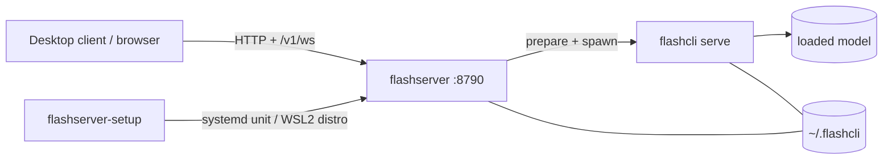

# flashserver

<p align="right"><strong>English</strong> · <a href="flashserver.zh-CN.md">简体中文</a></p>

`flashserver` is a resident scheduler for running models on one PC: it prepares,
loads, starts, and stops models, admits them against GPU memory, and exposes a
local console and HTTP API. Inference runs in `flashcli serve` child processes.



## Overview

- **One service, many models** — loads and unloads cached bundles on demand;
  admission is bounded by free VRAM and an optional slot limit.
- **Local console + HTTP API** — embedded UI at `http://localhost:8790/`, API
  reference at `/docs`, contract at `/openapi.yaml`, live state over `/v1/ws`.
- **Desktop client** — Windows package with overview, model management, logs, and
  settings.
- **Linux and Windows** — a systemd unit on Linux; a dedicated
  `flashserver_ubuntu` WSL2 distro plus logon task on Windows.
- **Local-first** — no remote mode; authentication is off by default and can be
  enabled with `--token`.

## Quick start

Windows: run `flashserver-setup-windows-amd64-v<version>.exe` (admin) and use the
client it opens.

Linux:

```bash
sudo flashserver-setup
```

Check the service:

```bash
curl -s http://127.0.0.1:8790/health
```

Load a model (desktop: Models → Load → Start):

```bash
curl -H 'Content-Type: application/json' \
  -d '{"ref":"flashcli-bundle/<name>:<version>"}' \
  http://127.0.0.1:8790/v1/models/load
```

## Documentation

| Topic | Doc |
|---|---|
| Install, config, ports, disk, lifecycle, uninstall, troubleshooting | [flashserver-install.md](flashserver-install.md) |
| Desktop client and per-model startup parameters | [flashserver-desktop.md](flashserver-desktop.md) |
| HTTP API index and examples | [flashserver-api.md](flashserver-api.md) · [openapi.yaml](openapi.yaml) |
| Internals (process model, shared host layer) | [architecture.md](architecture.md#local-service-stack-desktop-flashserver-flashserver-setup) |
| Installer acceptance on a clean VM | [installer/windows/README.md](../installer/windows/README.md) |
