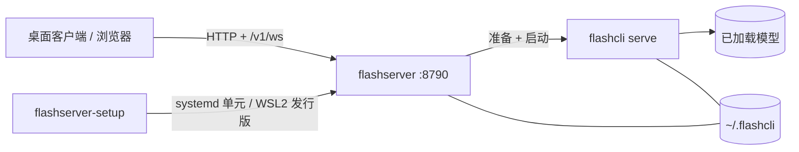

# flashserver

<p align="right"><a href="flashserver.md">English</a> · <strong>简体中文</strong></p>

`flashserver` 是单机常驻的模型调度器：负责模型准备、加载、启动、停止和 GPU 准入，
并提供本地控制台与 HTTP API；真正的推理在 `flashcli serve` 子进程中运行。



## 功能概述

- **一个服务，多个模型** —— 按需加载/卸载本地缓存的 bundle；准入受空闲显存和可选
  槽位上限约束。
- **本地控制台 + HTTP API** —— 内置页面 `http://localhost:8790/`，API 参考 `/docs`，
  契约 `/openapi.yaml`，实时状态走 `/v1/ws`。
- **桌面客户端** —— Windows 安装包提供概览、模型管理、日志和设置。
- **Linux 与 Windows** —— Linux 用 systemd 单元；Windows 用专用
  `flashserver_ubuntu` WSL2 发行版 + 登录任务。
- **本地优先** —— 不提供 remote 模式；默认关闭鉴权，可用 `--token` 开启。

## 快速开始

Windows：运行 `flashserver-setup-windows-amd64-v<version>.exe`（管理员），随后使用
它打开的客户端。

Linux：

```bash
sudo flashserver-setup
```

检查服务：

```bash
curl -s http://127.0.0.1:8790/health
```

加载模型（桌面：模型 → 加载 → 启动）：

```bash
curl -H 'Content-Type: application/json' \
  -d '{"ref":"flashcli-bundle/<name>:<version>"}' \
  http://127.0.0.1:8790/v1/models/load
```

## 文档导航

| 主题 | 文档 |
|---|---|
| 安装、配置、端口、磁盘、生命周期、卸载、排障 | [flashserver-install.zh-CN.md](flashserver-install.zh-CN.md) |
| 桌面客户端与按模型启动参数 | [flashserver-desktop.zh-CN.md](flashserver-desktop.zh-CN.md) |
| HTTP API 目录与示例 | [flashserver-api.zh-CN.md](flashserver-api.zh-CN.md) · [openapi.yaml](openapi.yaml) |
| 内部实现（进程模型、共享 host 层） | [architecture.zh-CN.md](architecture.zh-CN.md#本地服务栈desktopflashserverflashserver-setup) |
| 干净虚拟机上的安装验收 | [installer/windows/README.md](../installer/windows/README.md) |
