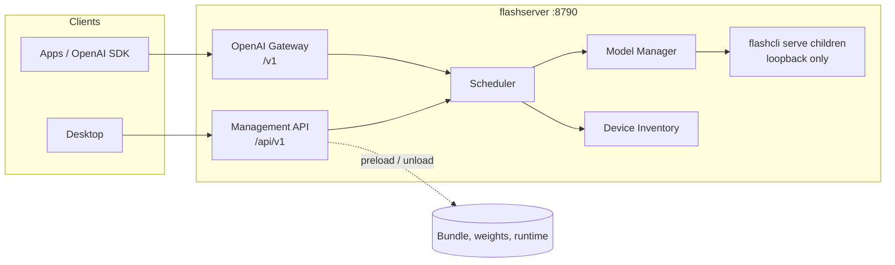
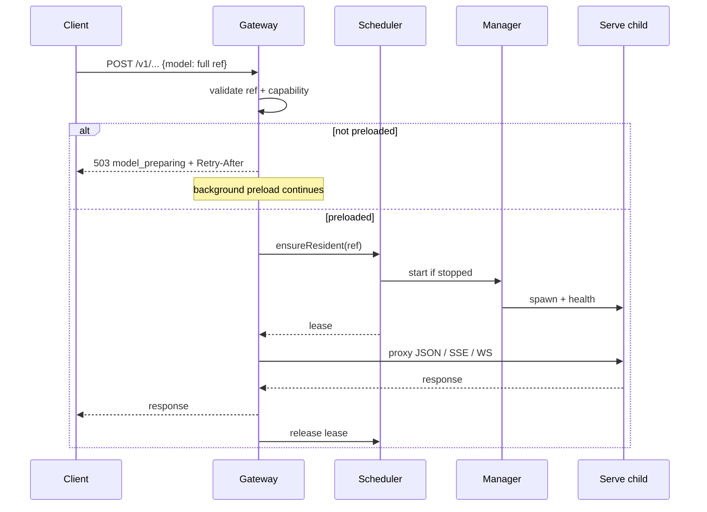
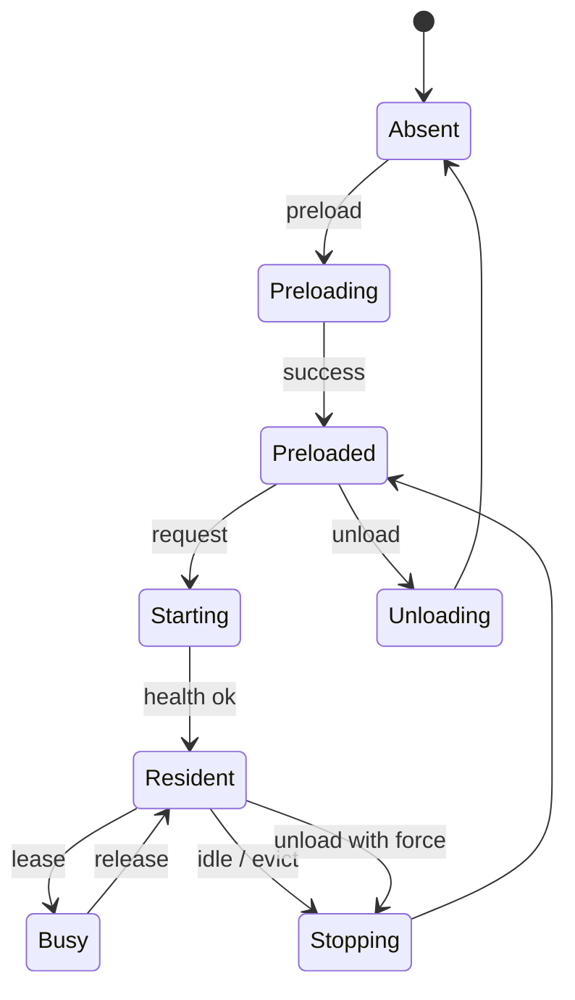

# flashserver OpenAI gateway and model scheduler

<p align="right"><strong>English</strong> · <a href="flashserver_gateway_scheduler_spec.zh-CN.md">简体中文</a></p>

**Authoritative contract for the flashserver data plane and scheduling.** Any
change to routes, states, admission, preload/unload, placement, or desktop/app
integration must update this document and its zh-CN mirror in the same change.

## 1. Scope and invariants

- One flashserver port exposes two namespaces:
  - `/v1/*`: OpenAI-compatible gateway.
  - `/api/v1/*`: management API.
- Applications and the desktop call only `/v1/*` for inference. They do **not**
  start, stop, load, unload, or select a device for a model.
- `model` is a **full bundle ref** (`flashcli-bundle/<name>:<version>`). Short
  names, aliases, latest-version lookup, and FlashHub catalog resolution are out
  of scope for this contract.
- Preload/remove are disk operations. Resident start/stop is internal scheduling.
- Bundle manifests declare supported runtime cells and resource requirements.
  They never select a device, GPU ID, or placement policy.
- The host is model-agnostic: no model-specific request/response or placement
  logic belongs in `go/`.

### 1.1 Architecture and request flow







## 2. Terms

| Term | Meaning |
|---|---|
| **preload** | Download the bundle and weights, create the runtime/venv, run preflight. Uses `host.Pull`. No serve process, no VRAM. |
| **unload** | Delete the bundle, weights, runtime/venv, and preload state. Requires the model to be stopped and have no active request (or `force`). |
| **resident start** | Internal: spawn `flashcli serve`, load weights into VRAM/RAM, wait for health. |
| **resident stop** | Internal: stop the serve process and free VRAM/RAM. Keeps preloaded assets. |
| **lease** | One active inference request holding a resident model. A model with leases cannot be evicted or unloaded without `force`. |
| **admission** | `max_loaded`, runtime compatibility, `min_vram_mib`/`min_ram_mib`, headroom, and device reservation. |
| **placement** | Host-only choice of device(s) and runtime cell for one resident model. |
| **queue** | Bounded wait when no placement is currently free. |

## 3. Model states

Disk state and resident state are independent.

```text
Disk:
  absent -> preloading -> preloaded -> unloading -> absent

Resident:
  stopped -> starting -> ready <-> busy -> stopping -> stopped
```

Public management status combines both:

```json
{
  "ref": "flashcli-bundle/qwen3_8b_nvfp4:1.0.0",
  "preload": "absent|preloading|preloaded|unloading",
  "resident": "stopped|starting|ready|busy|stopping",
  "active_requests": 0,
  "last_used": "2026-11-25T10:00:00Z",
  "device": {"kind": "cuda", "id": "0", "min_vram_mib": 8192},
  "capabilities": ["openai.chat"]
}
```

Rules:

- `preloaded` means assets are present; the model is not resident.
- Only `stopped` (no active requests) can be unloaded without `force`.
- A resident stop returns to `preloaded`, not `absent`.
- `force` may stop a busy model and cancel its requests before unloading.
- Auto idle eviction only performs resident stop; it never removes disk assets.

## 4. Routes

### 4.1 Gateway `/v1/*`

```text
GET  /v1/models
POST /v1/chat/completions
POST /v1/completions
POST /v1/responses
POST /v1/embeddings
POST /v1/moderations
POST /v1/audio/transcriptions
POST /v1/audio/translations
POST /v1/audio/speech
POST /v1/images/generations
POST /v1/images/edits
POST /v1/images/variations
POST /v1/videos
POST /v1/messages
POST /v1/messages/count_tokens
WS   /v1/realtime
```

- `GET /v1/models` returns the OpenAI list shape for **preloaded or resident**
  models. It does not enumerate the whole FlashHub catalog.
- A route is available only when the model declares the corresponding
  capability. Unsupported routes return the gateway's capability error; they
  are never silently forwarded.
- Child serve endpoints are internal and are never returned to applications.

### 4.2 Management `/api/v1/*`

```text
GET  /api/v1/models                 all known refs and their states
POST /api/v1/models/preload         {"ref":"...","force":false} -> 202 job
POST /api/v1/models/unload          {"ref":"...","wait_seconds":0,"force":false}
GET  /api/v1/devices                device inventory
GET  /api/v1/scheduler              queue, resident models, reservations
GET  /api/v1/jobs/{id}              job state/events
GET  /api/v1/ws                     management events
GET  /api/v1/settings               typed global settings
PATCH /api/v1/settings              {"mirror":{"enabled":true}}
GET  /api/v1/apps/*                 application install/prepare/setup/status
GET  /api/v1/logs                   logs
```

- App endpoints do **not** expose model start/stop. `app install`/`prepare`
  may preload default model refs; inference is always through `/v1`.
- Management API requires the flashserver token when configured.

## 5. Preload and unload

### 5.1 Preload

```http
POST /api/v1/models/preload
{"ref":"flashcli-bundle/<name>:<version>"}
```

- Starts an asynchronous job that invokes `host.Pull`.
- Idempotent: `preloading` or `preloaded` returns the existing state/job.
- Duplicate concurrent preloads for the same ref share one job.
- `force=true` re-lists/re-downloads the cached bundle tree and weights (cache
  repair). It is rejected with `409` while the model is resident.
- Failure leaves the job failed and keeps resumable download state.
- Preload never starts a serve process and never reserves VRAM.

### 5.2 Unload

```http
POST /api/v1/models/unload
{"ref":"...","wait_seconds":0,"force":false}
```

- If the model is resident or has active requests:
  - default: `409 model_busy`, no deletion.
  - `wait_seconds > 0`: wait up to that many seconds for leases to drain.
  - timeout: `409 model_busy`.
  - `force: true`: stop the process, cancel active requests, then delete.
- If not resident and no leases: stop if needed, then
  `host.RemoveCachedRef` and delete preload state.
- Shared bundle trees, weights, and runtime/venv are retained when another
  cached ref still uses them; the response reports `shared_bundle`,
  `shared_weights`, and `shared_runtime`.
- Unload is asynchronous when deletion is significant; return a job id.

## 6. Inference request flow

```text
client -> /v1/<route> {model: full-ref}
  -> auth
  -> validate full ref and capability for the route
  -> if not preloaded: start/reuse auto-pull job
       -> return 503 model_preparing (see Retry-After below)
  -> scheduler.ensureResident(ref)
       -> ready: lease++
       -> starting: wait/503 model_starting
       -> stopped: placement/admission/possible eviction/start
       -> no placement: queue or 503
  -> proxy to child endpoint (JSON / SSE / multipart / WebSocket)
  -> release lease; update last_used
  -> idle stop later; disk assets remain
```

- `n` choices, prompt arrays, and other work inside one request are sequential.
  Concurrency is across requests.
- Client disconnect cancels the upstream request and releases the lease.
- The response `model` field is rewritten to the requested full ref for JSON and
  SSE payloads.

## 7. Auto-pull and Retry-After

Auto-pull never blocks the first inference request indefinitely:

1. Start or reuse the preload job.
2. Return `503` with `Retry-After` and `X-Flashcli-Preload-Job`.
3. The client retries; the job continues in the background.
4. Once `preloaded`, the same request path starts the resident model.

Error body:

```json
{"error":{"message":"model is being preloaded","type":"server_busy",
  "code":"model_preparing","model":"flashcli-bundle/...","job_id":"..."}}
```

`Retry-After` policy (integer seconds, never `0`):

| Condition | Retry-After |
|---|---|
| Job queued behind another preload | `5` |
| ETA known (`remaining_bytes/rate` or progress) | `clamp(ceil(eta), 5, 60)` |
| No ETA, job age < 1 min | `5` |
| No ETA, 1–5 min | `15` |
| No ETA, 5–15 min | `30` |
| No ETA, > 15 min | `60` |
| Transient preload failure (retryable) | `10` |
| Permanent failure (bad ref, validation, disk) | no Retry-After |

Resident start uses the same pattern:

- Wait up to `resident_start_wait_seconds` (default `10`) for health.
- If not ready, return `503 model_starting` with `Retry-After: 2`; the start
  continues in the scheduler.
- If start fails permanently, return `502`/`503` without a retry hint.

Queue exhaustion returns `429 queue_full` with `Retry-After` from queue policy.
OpenAI SDKs already retry `429`/`5xx` and honor `Retry-After`.

## 8. Resource contract

### 8.1 Bundle manifest

Required for a GPU runtime:

```json
"resources": {"min_vram_mib": 8192}
```

Optional:

```json
"resources": {
  "gpu_count": 1,
  "min_ram_mib": 16384
}
```

- `min_vram_mib`: required per GPU for a GPU runtime.
- `gpu_count`: reserved for future multi-GPU models; default `1`. One model
  spanning multiple GPUs must declare it.
- `min_ram_mib`: optional CPU runtime admission requirement.
- No `cpu_cores` requirement; CPU may be slower but must not fail solely because
  cores are few.
- No device IDs, placement lists, CUDA_VISIBLE_DEVICES, or scheduling policy in
  the bundle.
- The runtime matrix declares device/OS/arch/runtime compatibility. A CPU
  runtime cell must exist for CPU placement; a missing cell means no CPU
  fallback.
- Rollout: declaring a `resources` block opts into strict validation; a GPU
  runtime must then include `min_vram_mib` and `bundle validate` rejects it
  otherwise. Legacy bundles with no `resources` block validate with a warning
  and are admitted without a declared VRAM requirement, so already-published
  bundles keep running.

### 8.2 Scheduler placement (host-only)

1. Enumerate WSL-visible devices: NVIDIA dGPUs via `nvidia-smi`, CPU/RAM via the
   host/cgroup limits. iGPU/AMD/Windows-native are out of scope.
2. Build runtime-compatible candidates for each device and the CPU.
3. Prefer a GPU placement when a compatible GPU runtime exists.
4. For `gpu_count > 1`, reserve that many GPUs each satisfying
   `min_vram_mib + vram_headroom_mib`; reservation is all-or-nothing.
5. If no compatible GPU runtime exists and the bundle has a CPU runtime cell,
   CPU is a candidate. CPU uses `min_ram_mib` when declared, otherwise a
   configurable RAM headroom and best-effort admission.
6. If a compatible GPU runtime exists but VRAM is temporarily insufficient,
   **do not** fall back to CPU. Evict idle residents, queue, or return 503.
7. No candidate: `503 no_placement` (`no_compatible_runtime` or
   `resource_exhausted`).
8. Idle LRU eviction stops residents with no leases; it never deletes assets and
   never evicts a busy model.

Telemetry is exposed at `/api/v1/devices` and `/api/v1/scheduler`.

## 9. Configuration

```json
{
  "max_loaded": 2,
  "vram_headroom_mib": 6144,
  "idle_stop_seconds": 600,
  "resident_start_wait_seconds": 10,
  "queue_timeout_seconds": 30,
  "queue_max": 16,
  "auto_pull": true,
  "cpu_fallback": "no-gpu-runtime"
}
```

- `vram_headroom_mib` defaults to 6144 MiB and can be overridden by
  `FLASHCLI_VRAM_HEADROOM_MIB` (or the config file).
- `cpu_fallback` is `no-gpu-runtime` (default) or `disabled`; capacity never
  triggers CPU fallback.
- Auto-pull returns the standard 503 immediately with `Retry-After`; the
  gateway does not block on a preload.
- Values are validated at startup; invalid values fail fast.

## 10. Application and desktop contract

- Applications install or preload full refs; they never start/stop/load/unload
  models or receive child endpoints.
- Setup scripts receive `FLASHCLI_API_BASE=http://<host>:8790/v1`.
- App state does not persist `pid`/child `endpoint` as an inference entry.
- Desktop management calls use `/api/v1/*`; inference examples use `/v1/*`.
- Desktop may show preload/unload (disk) and resident status, but offers no
  application-level model start/stop.
- The desktop must be updated in the same change as the route split; there is no
  backward-compatibility requirement.

## 11. Security and observability

- The gateway and management API share the flashserver token; OpenAI clients use
  `Authorization: Bearer`.
- Child serve endpoints bind loopback and are never exposed.
- The gateway strips the client token before forwarding.
- Log per request: model, capability, preload/resident decision, placement,
  queue wait, upstream status, lease release.
- Emit preload/unload/start/stop/evict events over `/api/v1/ws`.

## 12. Validation and acceptance

Unit tests:

- Full-ref validation, capability routing, error mapping.
- Preload/unload idempotency, active lease wait/409/force, shared asset retention.
- Auto-pull job dedupe, Retry-After policy, retry after completion.
- Scheduler admission, LRU idle stop, max_loaded, VRAM headroom, queue.
- Multi-GPU `gpu_count` reservation and CPU runtime fallback.
- WSL device inventory and no-placement paths.

Integration/acceptance:

- Fake model child: JSON, SSE, multipart, WebSocket, client cancellation.
- Real `ServeEngine` bundle pulled through a fake FlashHub: preload → daemon restart keeps preloaded state → JSON/SSE → unload busy/force (`tests/acceptance/test_gateway_server.py`).
- Request auto-pulls an absent model; retry after preload succeeds.
- Idle resident stops without deleting assets; next request reuses assets.
- `unload` while busy: 409/waits/force.
- CPU fallback only when no compatible GPU runtime exists.
- App install/preload + inference through `/v1` only; no endpoint usage.

## 13. Out of scope

- Short model names, aliases, latest-version resolution, FlashHub catalog lookup.
- iGPU, AMD, Windows-native runtime, removal of WSL.
- Cross-GPU tensor-parallel topology requirements beyond `gpu_count`.
- Model-specific parameter schemas; future bundle specs will declare them and
  the gateway will apply generic schema validation.
- Application-level model start/stop or endpoint access.
