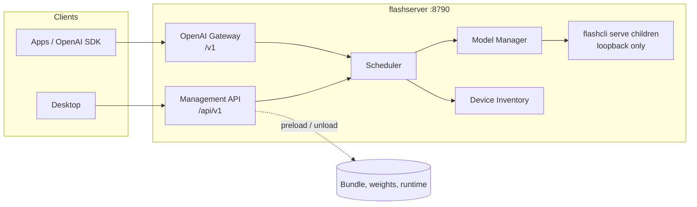
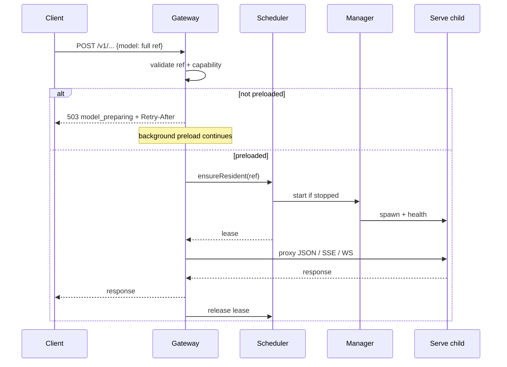
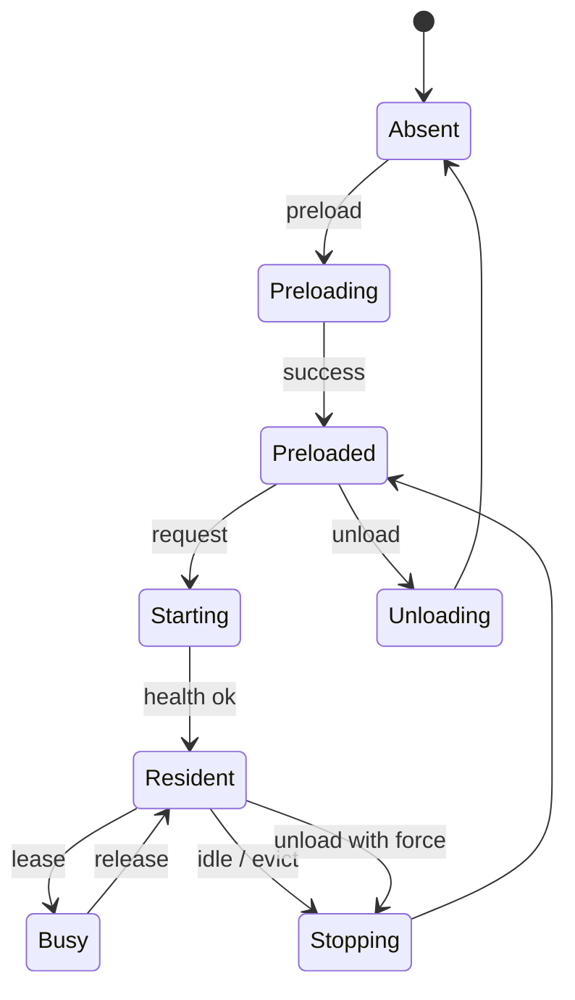

# flashserver OpenAI 网关与模型调度

<p align="right"><a href="flashserver_gateway_scheduler_spec.md">English</a> · <strong>简体中文</strong></p>

**flashserver 数据面与调度的权威契约。** 任何路由、状态、准入、preload/unload、
placement、桌面/应用对接的改动，都必须在同一次变更中更新本文档及英文原文。

## 1. 范围与不变量

- flashserver 单个端口提供两个命名空间：
  - `/v1/*`：OpenAI 兼容网关。
  - `/api/v1/*`：管理 API。
- 应用和桌面只通过 `/v1/*` 做推理，**不能**启动/停止/加载/卸载模型，也不能选择设备。
- `model` 只接受完整 bundle ref（`flashcli-bundle/<name>:<version>`）。短名、alias、
  latest 解析和 FlashHub 目录查询不在本契约范围内。
- preload/remove 是磁盘操作；resident start/stop 是内部调度，不对外暴露。
- bundle 只声明支持的 runtime cell 和资源需求，不选择设备/GPU ID/placement。
- host 与模型无关：`go/` 中不得出现具体模型的请求/响应或调度逻辑。

### 1.1 架构与请求流程







## 2. 术语

| 术语 | 含义 |
|---|---|
| **preload** | 下载 bundle 和权重、创建 runtime/venv、执行 preflight。使用 `host.Pull`。不启动 serve，不占显存。 |
| **unload** | 删除 bundle、权重、runtime/venv 和 preload 状态。要求模型已停止且没有 active 请求（或 `force`）。 |
| **resident start** | 内部：启动 `flashcli serve`，加载权重到显存/内存，等待 health。 |
| **resident stop** | 内部：停止 serve，释放显存/内存，保留磁盘资产。 |
| **lease** | 一个 active 推理请求持有 resident 模型。有 lease 的模型不能被驱逐或普通 unload。 |
| **admission** | `max_loaded`、runtime 兼容性、`min_vram_mib`/`min_ram_mib`、headroom、设备预留。 |
| **placement** | host 内部为一个 resident 模型选择设备/runtime cell。 |
| **queue** | 暂时没有可用 placement 时的有界等待。 |

## 3. 模型状态

磁盘状态和 resident 状态相互独立。

```text
磁盘:
  absent -> preloading -> preloaded -> unloading -> absent

Resident:
  stopped -> starting -> ready <-> busy -> stopping -> stopped
```

管理状态示例：

```json
{
  "ref": "flashcli-bundle/qwen3_8b_nvfp4:1.0.0",
  "preload": "absent|preloading|preloaded|unloading",
  "resident": "stopped|starting|ready|busy|stopping",
  "active_requests": 0,
  "last_used": "2026-11-25T10:00:00Z",
  "device": {"kind": "cuda", "id": "0", "min_vram_mib": 8192},
  "capabilities": ["openai.chat"]
}
```

规则：

- `preloaded` 表示资产已准备，但没有 serve 进程。
- 只有 `stopped` 且无 active 请求才能普通 unload。
- resident stop 回到 `preloaded`，不是 `absent`。
- `force` 可以停止 busy 模型并取消请求后再 unload。
- 自动空闲淘汰只做 resident stop，绝不删除磁盘资产。

## 4. 路由

### 4.1 网关 `/v1/*`

```text
GET    /v1/models
GET    /v1/models/{id}
POST   /v1/chat/completions
POST   /v1/completions
POST   /v1/responses
GET    /v1/responses/{id}
DELETE /v1/responses/{id}
POST   /v1/responses/{id}/cancel
POST   /v1/embeddings
POST   /v1/moderations
POST   /v1/audio/transcriptions
POST   /v1/audio/translations
POST   /v1/audio/speech
POST   /v1/images/generations
POST   /v1/images/edits
POST   /v1/images/variations
POST   /v1/videos
GET    /v1/videos
GET    /v1/videos/{id}
DELETE /v1/videos/{id}
GET    /v1/videos/{id}/content
POST   /v1/messages
POST   /v1/messages/count_tokens
WS     /v1/realtime
*      /v1/<custom-path>
```

- `/v1/models` 和 `/v1/models/{id}` 由 host 拥有，只列 **preloaded 或 resident** 的
  模型，不返回整个 FlashHub 目录。带 `anthropic-version` 时返回 Anthropic 结构。
- 标准路由只有在模型声明了对应 capability 时才可用；未声明时返回 capability
  错误，不会静默转发。
- 其他 `/v1/*` 路径都是 **custom path**，由 bundle 的 `register_routes` 拥有。
  网关原样转发 method、path、剩余 query、body、SSE 和二进制响应。custom path
  **不**做 capability 门控，由 bundle 决定路由是否存在。
- custom 请求用 body `model`（JSON/multipart）或 `?model=<full-ref>`
  （GET/DELETE/HEAD 以及 body 不带 `model` 的请求）选择模型。网关转发前会剥离
  `model` query；两个选择器不一致时返回 `400 model_conflict`。
- `/v1/models*`、`/v1/responses/*`、`/v1/videos/*` 保留给 host 路由，永远不会作为
  custom path 转发。已知标准路径的 method 不匹配返回 `405` + `Allow`；保留命名空间
  下的非法路径返回 `404`。
- 不支持 custom WebSocket 路由；实时场景使用 `/v1/realtime`。
- child serve endpoint 只在内部使用，绝不返回给应用。

### 4.2 管理 `/api/v1/*`

```text
GET  /api/v1/models
POST /api/v1/models/preload         {"ref":"...","force":false} -> 202 job
POST /api/v1/models/unload          {"ref":"...","wait_seconds":0,"force":false}
GET  /api/v1/devices
GET  /api/v1/scheduler
GET  /api/v1/jobs/{id}
GET  /api/v1/ws
GET  /api/v1/settings               类型化全局设置
PATCH /api/v1/settings              {"mirror":{"enabled":true}}
GET/POST/DELETE /api/v1/apps/*      应用 install/prepare/setup/status
GET  /api/v1/logs
```

- 应用接口**不提供**模型 start/stop；`app install/prepare` 可以 preload 默认模型，
  推理一律走 `/v1`。
- 配置 token 后管理 API 需要鉴权。

## 5. preload 与 unload

### 5.1 preload

```http
POST /api/v1/models/preload
{"ref":"flashcli-bundle/<name>:<version>"}
```

- 启动异步 job，内部调用 `host.Pull`。
- 幂等：preloading/preloaded 返回已有状态/job。
- 同一 ref 的并发 preload 共享一个 job。
- `force=true` 重新列取/下载已缓存的 bundle 树和权重（缓存修复）；模型 resident 时
  返回 `409`。
- 失败保留 job 错误和可续传的下载状态。
- 不启动 serve，不预留显存。

### 5.2 unload

```http
POST /api/v1/models/unload
{"ref":"...","wait_seconds":0,"force":false}
```

- 模型 resident 或有 active 请求时：
  - 默认 `409 model_busy`，不删除。
  - `wait_seconds > 0`：最多等待这么多秒。
  - 超时 `409 model_busy`。
  - `force: true`：停止进程、取消请求，再删除。
- 非 resident 且无 lease：必要时先 stop，再 `host.RemoveCachedRef` 并删除 preload 状态。
- 共享 bundle/权重/runtime 仍被其他 ref 使用时保留；响应返回
  `shared_bundle` / `shared_weights` / `shared_runtime`。
- 删除较大时异步执行并返回 job id。

## 6. 推理请求流程

```text
client -> /v1/<route> {model: full-ref}
  -> auth
  -> 校验完整 ref 与路由 capability
  -> 未 preloaded：启动/复用 auto-pull job
       -> 返回 503 model_preparing（见 Retry-After）
  -> scheduler.ensureResident(ref)
       -> ready：lease++
       -> starting：等待/503 model_starting
       -> stopped：placement/admission/可能的 eviction/start
       -> 无 placement：排队或 503
  -> 代理到 child endpoint（JSON / SSE / multipart / WebSocket）
  -> 释放 lease；更新 last_used
  -> 空闲后内部 stop；磁盘资产保留
```

- 单请求内部的 `n`、prompt 数组等仍是串行；并发发生在请求之间。
- 客户端断开时取消上游并释放 lease。
- 标准路由校验路由 capability；custom path 跳过该检查，但仍然获取 lease，
  避免请求进行中模型被驱逐。
- JSON 和 SSE 响应中的 `model` 为字符串时重写为请求的完整 ref。超过网关 body
  上限的 JSON 响应会直接流式透传，不再缓冲或截断。

### 6.1 按请求形态选择模型

网关不会根据路由或“唯一 resident”猜测模型，始终需要显式的完整 bundle ref。该
ref 同时是缓存 key 和调度 key，不是展示名。

| 请求 | 网关读取 `model` 的位置 |
|---|---|
| `POST /v1/chat/completions`、`/completions`、`/responses`、`/embeddings`、`/moderations`、`/audio/speech`、`/images/generations`、`/messages`、`/messages/count_tokens` | JSON body `model` |
| `POST /v1/audio/transcriptions`、`/audio/translations`、`/images/edits`、`/images/variations`、`/v1/videos` | multipart form 字段 `model`；`/v1/videos` 也接受 JSON body `model` |
| `WS /v1/realtime` | `?model=<full-ref>` |
| `GET /v1/videos`、`GET/DELETE /v1/videos/{id}`、`GET /v1/videos/{id}/content` | `?model=<full-ref>` |
| `GET/DELETE /v1/responses/{id}`、`POST /v1/responses/{id}/cancel` | `?model=<full-ref>` |
| custom `/v1/*` JSON/multipart | body/form `model`；body 故意不带时用 `?model=` |
| custom `/v1/*` GET/DELETE/HEAD/其他 body | `?model=<full-ref>` |
| `GET /v1/models`、`GET /v1/models/{id}` | 不选模型；只做列表/详情 |

规则：

- 必须是完整 FlashHub ref（`flashcli-bundle/<name>:<version>`）；短名/alias 返回
  `400 invalid_model`。
- body/form 和 query 同时出现时必须一致；不一致返回 `400 model_conflict`。
- 转发前剥离 `model` query；path 和 body 保持不变。
- custom JSON body 可以是数组或标量；只有对象中的字符串 `model` 才作为选择器。
  没有时必须有 query 选择器。
- child 自己的 `model_id` 不参与路由；网关会把字符串响应 `model` 重写回请求的完整 ref。

## 7. auto-pull 与 Retry-After

auto-pull 不应无限阻塞首个推理请求：

1. 启动/复用 preload job。
2. 返回 `503`、`Retry-After`、`X-Flashcli-Preload-Job`。
3. 客户端重试；job 在后台继续。
4. preloaded 后，同一请求路径启动 resident。

错误体：

```json
{"error":{"message":"model is being preloaded","type":"server_busy",
  "code":"model_preparing","model":"flashcli-bundle/...","job_id":"..."}}
```

`Retry-After` 策略（整数秒，不能为 0）：

| 情况 | Retry-After |
|---|---|
| 排在另一个 preload 后面 | `5` |
| 已知 ETA（剩余字节/速率或进度） | `clamp(ceil(eta), 5, 60)` |
| 无 ETA，job < 1 分钟 | `5` |
| 无 ETA，1–5 分钟 | `15` |
| 无 ETA，5–15 分钟 | `30` |
| 无 ETA，> 15 分钟 | `60` |
| 可重试的 preload 失败 | `10` |
| 永久失败（坏 ref/校验/磁盘） | 不返回 Retry-After |

resident start 同样处理：

- 最多等待 `resident_start_wait_seconds`（默认 `10`）完成 health。
- 未 ready 返回 `503 model_starting` + `Retry-After: 2`，scheduler 继续启动。
- 永久失败返回 `502`/`503`，不带重试提示。

队列耗尽返回 `429 queue_full`，`Retry-After` 按队列策略。OpenAI SDK 本身会重试
`429`/`5xx` 并遵守 `Retry-After`。

## 8. 资源契约

### 8.1 bundle manifest

GPU runtime 必填：

```json
"resources": {"min_vram_mib": 8192}
```

可选：

```json
"resources": {
  "gpu_count": 1,
  "min_ram_mib": 16384
}
```

- `min_vram_mib`：每个 GPU 的最低显存要求。
- `gpu_count`：预留给未来多卡模型，默认 `1`；一个模型跨多卡时必须声明。
- `min_ram_mib`：CPU runtime 可选的内存准入要求。
- 不要求 `cpu_cores`；CPU 少核只影响速度，不能仅因此失败。
- 不允许设备 ID、placement 列表、CUDA_VISIBLE_DEVICES 或调度策略。
- runtime matrix 声明设备/OS/arch/runtime 兼容性；没有 CPU runtime cell 就不能
  CPU 回退。
- 过渡期：声明 `resources` 块即进入严格校验，GPU runtime 必须包含 `min_vram_mib`，
  否则 `bundle validate` 拒绝。没有 `resources` 块的 legacy bundle 只产生警告，并按
  未声明显存要求准入，保证已发布 bundle 仍可运行。

### 8.2 placement（host 内部）

1. 枚举 WSL 可见设备：`nvidia-smi` NVIDIA dGPU，host/cgroup 的 CPU/RAM。
   iGPU/AMD/Windows native 暂不支持。
2. 为每个设备和 CPU 构造 runtime 兼容候选。
3. 有兼容 GPU runtime 时优先 GPU。
4. `gpu_count > 1` 时预留同样数量的 GPU，每张都要满足 VRAM 需求：已声明的 bundle 为
   `min_vram_mib + vram_headroom_mib`，未声明 `min_vram_mib` 的 legacy bundle 使用保守的
   6144 MiB 下限（`FLASHCLI_VRAM_HEADROOM_MIB=0` 可关闭预留）；全部成功或全部失败。
5. 没有兼容 GPU runtime 且 bundle 有 CPU runtime cell 时，CPU 才是候选。
   CPU 用 `min_ram_mib`（如果声明），否则使用可配置 RAM headroom，best-effort 准入。
6. **有 GPU runtime 但显存暂时不足时，不降级 CPU**；先淘汰空闲 resident、排队或 503。
7. 无候选：`503 no_placement`（`no_compatible_runtime` 或 `resource_exhausted`）。
8. 空闲 LRU 只停止无 lease 的 resident；不删资产，不驱逐 busy 模型。

设备与调度状态通过 `/api/v1/devices`、`/api/v1/scheduler` 暴露。

## 9. 配置

```json
{
  "max_loaded": 0,
  "vram_headroom_mib": 512,
  "idle_stop_seconds": 600,
  "resident_start_wait_seconds": 10,
  "queue_timeout_seconds": 30,
  "queue_max": 16,
  "auto_pull": true,
  "cpu_fallback": "no-gpu-runtime"
}
```

- `max_loaded` 默认 `0`（不限制槽位）；placement 由兼容 GPU/CPU 和可用内存决定，而不是
  任意模型数量。
- `vram_headroom_mib` 默认 512 MiB，可用 `FLASHCLI_VRAM_HEADROOM_MIB`（或配置文件）覆盖。
  未声明 `resources.min_vram_mib` 的 bundle 改为至少预留 6144 MiB；
  `FLASHCLI_VRAM_HEADROOM_MIB=0` 可关闭预留。
- `cpu_fallback` 默认 `no-gpu-runtime`，或 `disabled`；容量不足永不触发 CPU 回退。
- auto-pull 立即返回标准 503 + `Retry-After`；网关不会阻塞等待 preload。
- 启动时校验配置，非法值直接失败。

## 10. 应用与桌面契约

- 应用只 install/preload 完整 ref；不 start/stop/load/unload 模型，不接收 child endpoint。
- setup 脚本通过命令行参数获得 `{base_url}`、`{model}`（第一个完整 bundle ref）和
  `{api_key}`；`HOME`/`USERPROFILE` 指向配置的客户端 home。daemon 不导出
  `FLASHCLI_API_BASE`。
- AppState 不再把 `pid`/child `endpoint` 作为推理入口。
- 桌面管理调用 `/api/v1/*`，推理示例使用 `/v1/*`。
- 桌面可显示 preload/unload（磁盘）和 resident 状态，但不提供应用级模型启停。
- 桌面必须在同一次变更中完成路由迁移；不要求兼容旧版本。

## 11. 安全与可观测性

- 网关与管理 API 共用 flashserver token；OpenAI 客户端使用 `Authorization: Bearer`。
- child serve 只绑定 loopback，绝不对外暴露。
- 网关转发前移除客户端 token。
- 每个请求记录：model、capability、preload/resident 决策、placement、排队时间、
  上游状态、lease 释放。
- 通过 `/api/v1/ws` 推送 preload/unload/start/stop/evict 事件。

## 12. 校验与验收

单元测试：

- 完整 ref 校验、capability 路由、错误映射。
- custom `/v1/*` 透传：body/query 选模型、`model_conflict`、剥离选择器、
  method/path/query/body 保持、跳过 capability 门控、lease 释放、拒绝 custom
  WebSocket。
- 保留的 host 路径保持 `405`/`Allow` 语义；`/v1/models/{id}` 由 host 拥有，不转发。
- 客户端取消或上游流中断都会释放 lease，并保留已输出的部分内容。
- preload/unload 幂等、active lease 等待/409/force、共享资产保留。
- auto-pull job 去重、Retry-After 策略、完成后重试成功。
- 调度准入、LRU 空闲 stop、max_loaded、VRAM headroom、队列。
- 多卡 `gpu_count` 预留和 CPU runtime 回退。
- WSL 设备盘点和 no-placement 路径。

集成/验收：

- 假 child：JSON、SSE、multipart、WebSocket、客户端取消。
- 通过 fake FlashHub 拉取真实 `ServeEngine` bundle：preload → daemon 重启后仍为 preloaded → JSON/SSE → busy/force unload（`tests/acceptance/test_gateway_server.py`）。
- 缺失模型自动 preload，重试后推理成功。
- 空闲 resident stop 不删资产，下次请求复用资产。
- busy 时 unload：409/等待/force。
- 只有无兼容 GPU runtime 时才 CPU 回退。
- 应用 install/preload + 只通过 `/v1` 推理，不使用 endpoint。

真实 GPU + 公开模型验收（可选、可复现）：

```bash
bash scripts/build_dev_bins.sh
python3 scripts/verify_scheduler_public.py
```

默认 `8795` 被占用（例如 Windows Hyper-V 排除端口段）时设置
`FLASHCLI_SCHEDULER_PORT`。

脚本默认使用 `xym/hunyuan_05b_instruct_rtx:1.0.0` 和
`xym/ernie45_0p3b_rtx:1.0.0`（可用 `FLASHCLI_SCHEDULER_MODEL_A/B` 覆盖），在单张
8 GiB GPU 上覆盖：

- 默认 `max_loaded=0`，两个真实模型同时驻留同一张卡；
- 空闲 stop 保留磁盘 preload，下一次请求重新启动；
- 杀死 serve 子进程后，下一次请求只重启一次；
- VRAM hog 占用显存时，真实空闲显存准入拒绝启动；
- `max_loaded=1`：第二个模型排队并在超时后返回 `no_placement`；
- 第一个模型空闲后，LRU 淘汰并启动第二个模型；
- 活跃流进行中重启 daemon：客户端流被中断，磁盘 preload 保留，下一次请求用新的
  resident 服务；
- busy unload 返回 409，`wait_seconds` 返回 409，`force` 中断流并释放 lease。

首次运行需要网络；脚本保留 home/cache，后续运行更快
（`FLASHCLI_SCHEDULER_HOME`，`FLASHCLI_SCHEDULER_FRESH=1` 可重置）。

## 13. 不在范围内

- 短模型名、alias、latest 解析、FlashHub 目录查询。
- iGPU、AMD、Windows native、去掉 WSL。
- 超出 `gpu_count` 的跨 GPU tensor-parallel 拓扑要求。
- 模型专属参数 schema；未来由 bundle 规范声明，网关做通用 schema 校验。
- 应用级模型启停或 endpoint 访问。
