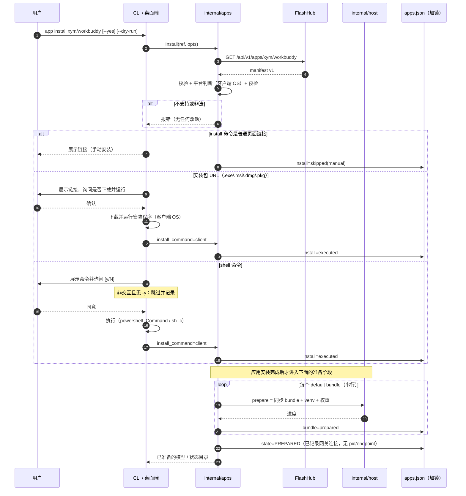
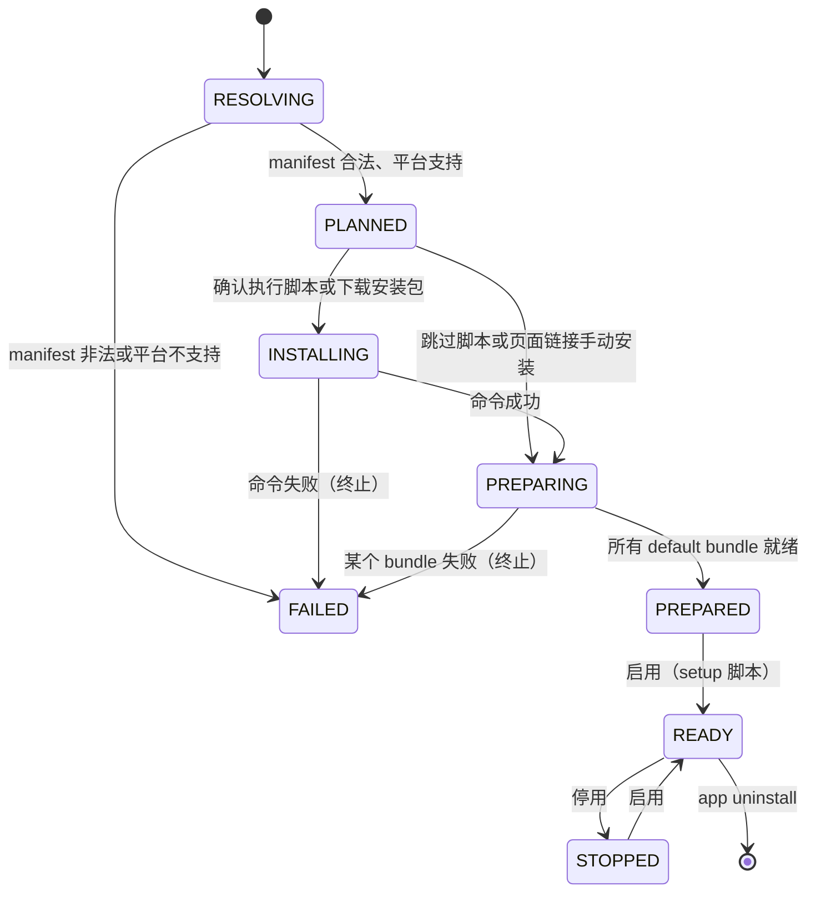

# FlashHub 应用安装计划

<p align="right"><a href="application_install_plan.md">English</a> · <strong>简体中文</strong></p>

> **状态：已实现（v1）。** manifest 规范见
> [app_manifest_standard.zh-CN.md](../app_manifest_standard.zh-CN.md)（v1，与 FlashHub 实际一致）。

## 目标

一条命令完成应用安装、模型准备并保持可用：

```bash
flashcli app install xym/workbuddy
```

`flashcli` 必须能在**没有** `flashserver` 运行时独立工作；守护进程与 CLI 共用同一套
Go 实现（`internal/apps`），桌面只通过 HTTP 访问守护进程。

## 术语

| 术语 | 含义 |
|---|---|
| **Application** | FlashHub 上发布的外部应用（如 `xym/workbuddy`） |
| **App key** | `[namespace/]name[:version]` |
| **Manifest** | `flashcli-application` 文档（见规范） |
| **Model bundle** | 现有 `flashcli-bundle/<name>:<version>` 运行时 |
| **常驻守护进程** | `flashserver`（调度器、控制台、API，保持不变） |

## 职责

| 组件 | 负责 |
|---|---|
| FlashHub | 应用注册、版本、manifest 校验、元数据 |
| `internal/apps`（共享） | manifest 使用、安装策略、应用状态、模型准备与生命周期 |
| `internal/modelrun`（共享） | 监管 `flashcli serve` 子进程（端口、健康、日志、停止） |
| `flashcli` CLI | 用户交互、确认、退出码、JSON 输出 |
| `flashserver` | 供桌面使用的 HTTP API；调用同一共享包 |
| `flashcli-desktop` | 仅 UI；HTTP/WS 访问 `flashserver` |

CLI 的应用操作**不需要**（也不使用）对守护进程的 HTTP 调用。

## App key

`xym/workbuddy` 解析最新版本；`xym/workbuddy:1.0.0` 固定版本。
`flashcli app install` 会记录解析出的版本。

## Manifest

`GET /api/v1/apps/{namespace}/{name}[:version]` 返回 manifest。host 校验
`format`、`app_format_version`、`protocol_version`、必填字段，以及 `name`/`version`
与 key 一致。详见 [app_manifest_standard.zh-CN.md](../app_manifest_standard.zh-CN.md)。

## 安装流程

**安装和启用是两个独立操作**。安装负责解析/校验 manifest、安装应用本体、准备模型
bundle；**不会启动模型，也不会执行 setup 脚本**。启用是显式操作（桌面「启用」/
`POST /api/v1/apps/.../activate`），会针对 flashserver 网关执行已确认的 setup 脚本。

```text
RESOLVE → VALIDATE → PLATFORM → PREFLIGHT → PLAN
  → CONFIRM_INSTALL（shell 命令或安装包下载；普通页面链接：手动）
  → INSTALL_APP（脚本：执行 | 安装包 URL：下载并运行 | 页面：打开/复制）
  → PREPARE_MODELS（所有 default bundle，串行）
  → PREPARED（已缓存；已记录网关连接；未运行）
```



### 启用流程（独立操作）

```text
ACTIVATE → READY + 网关连接 → SETUP_SCRIPTS（已确认，按 manifest 顺序）
```

启用**不会启动模型**：它把应用标为 ready、写入网关连接（`http://<host>:<port>/v1`），
并按确认结果执行 setup 脚本，`{base_url}` 指向该网关。setup 失败只写日志，应用保持
`READY`。停用把应用标为 `STOPPED`，不停止任何进程（模型归 flashserver 调度器管理）。
重新安装保留缓存，并把应用恢复到 `PREPARED`。

### 状态机



`status` 返回已记录的启用状态。启用/停用按应用串行化。应用不保存模型 PID 或 child
endpoint；网关连接稳定，推理在请求时按需启动。

daemon 启动时，被中断的 `installing`/`preparing` 变为 `failed` 并提示重新安装；
应用不再使用 `starting`/`stopping` 启动模型。

### 配置脚本（可选）

启用时，host 按 manifest 顺序执行 `setup.scripts`，只执行用户**本次**确认过的脚本。
确认点是客户端（桌面端启用时的确认框，或 CLI 对每个脚本的提示）。每个脚本都会下载、
校验 `sha256`，并用显式 argv 模板执行
（`{base_url}` = flashserver 网关、`{model}`、`{api_key}`）。失败会写入应用 job 日志并
停止后续脚本，但应用保持 `READY`；没有 `setup.scripts` 的应用跳过此步骤。确认的选择
会持久化，供下一次启用使用。

### 失败与回滚

- **安装命令失败**立即终止，不再准备模型
- **准备失败**终止；已准备的 bundle 保留缓存，重跑可续
- **setup 脚本失败**写入应用日志、停止后续脚本，应用保持 `ready`
- 重复执行 `app install` 幂等：补齐缺失的准备步骤；只有 `--force` 才会重跑
  安装脚本；安装从不启动模型

## 命令

```bash
flashcli app list   [--json]
flashcli app show   <key> [--json]
flashcli app install <key> [--yes|-y] [--dry-run] [--force]
                     [--bundle REF]... [--no-install] [--no-model]
flashcli app status <key> [--json]
flashcli app logs   <key> [--ref REF] [--lines N] [-f]
flashcli app uninstall <key> [--yes] [--purge-models]
```

规则：

- 任何 shell 执行都要显式确认；`--yes` 免询问；非交互无 `--yes` 时跳过并记 `skipped`
- URL 由客户端处理：CLI 只打印链接（不下载）；桌面端在用户确认后下载并运行安装包
  （.exe/.msi → Windows，.dmg/.pkg → macOS），普通页面链接在浏览器打开
- 应用安装成功后才准备 bundle；安装失败会中止整个流程
- 安装/启用/停用按应用串行；桌面端在安装进行中禁用其他应用，并在卡片与页面顶部显示
  该应用的安装进度
- 推理通过 flashserver 网关按需启动；应用没有自己的模型端口，也没有模型 start/stop 命令
- `uninstall` 移除应用状态；默认保留模型缓存（`--purge-models` 才清理）

## 入口

CLI、守护进程、桌面端都调用同一个 `internal/apps`，区别只在于「是否执行安装脚本」
这个决定怎么拿到：

| 入口 | 安装脚本决策 |
|---|---|
| `flashcli app install` | 终端上询问 `[y/N]`；`--yes` 直接执行；没有终端且无 `--yes` 时跳过并记录 `skipped` |
| `flashserver` `POST /api/v1/apps/{org}/{name}/install` | 必须带 `install_command: "run" \| "skip" \| "client"`（否则 400）；作为 `app-install` 作业准备模型，不启动模型 |
| `flashserver` `POST /api/v1/apps/{org}/{name}/activate` | 标记应用 ready、写入网关连接、执行 `setup_scripts` + `client_home`（作业 `app-activate`）；不启动模型 |
| `flashserver` `POST /api/v1/apps/{org}/{name}/deactivate` | 标记应用 stopped；不停止任何模型进程 |
| `flashcli-desktop` 应用页 | 「安装」弹窗展示命令：「运行脚本并安装」在**客户端 OS 本地**执行后发 `client`；「跳过脚本安装」发 `skip`；取消则什么也不做。启用时询问要执行哪些 setup 脚本；作业进度显示在详情区 |

### 平台归属

应用本体和模型不在同一个平台：应用装在用户实际使用的系统（例如 Windows 的
exe），模型跑在 WSL/守护进程所在主机。因此：

- manifest 的平台校验与命令选择使用**客户端**平台（API 的 `client_os`/`client_arch`，
  桌面端传自己的 OS/arch）；不传时守护进程回退到自身平台（CLI 行为）。
- 安装命令由桌面端自己执行（Windows 用 `powershell -Command`，其他系统用 `sh -c`），
  然后告诉守护进程 `install_command: "client"`；守护进程只记录「已执行」，绝不在
  WSL 里跑客户端 exe。
- 准备 bundle 由守护进程负责，与客户端平台无关；推理通过网关按需启动，启用不会为应用
  启动模型进程。

卸载在三端都可用（`DELETE /api/v1/apps/{org}/{name}`；桌面「卸载」可选 `purge_models`），
但都不会卸载应用自身安装的文件。

## 本地状态

CLI 与守护进程共享 `$FLASHCLI_HOME/flashserver/apps.json`（跨进程文件锁；写入原子
rename）：

```json
{
  "apps": {
    "xym/workbuddy:1.0.0": {
      "version": "1.0.0",
      "state": "prepared",
      "installed_at": "2026-11-17T08:00:00Z",
      "install": {"command": "irm … | iex", "executed": true},
      "models": [
        {"ref": "xym/gemma4_e2b_it:1.0.1", "id": "gemma4_e2b_it",
         "prepared": true}
      ],
      "setup_scripts": ["workbuddy"],
      "setup_plan": [{"key": "workbuddy", "url": "…", "sha256": "…"}],
      "setup_client_home": "C:\\Users\\…",
      "last_log": ["activating …", "setup workbuddy: done"],
      "connection": {"base_url": "http://127.0.0.1:8790/v1", "api_key": "local",
                     "models": ["gemma4_e2b_it"],
                     "model_refs": ["xym/gemma4_e2b_it:1.0.1"]}
    }
  }
}
```

安装后是 `prepared`，已记录网关连接，没有 `pid`/`endpoint`；启用写入 `ready`，
停用写入 `stopped`。应用不拥有模型进程或 child endpoint。

## 模型生命周期

- `internal/apps` 通过 `internal/host` 准备 bundle（与 `flashserver` 相同的 preload
  路径）；不启动模型、不分配端口
- 准备是离线优先的：权重缓存与下载清单完整时直接复用，不访问模型 Hub；只有显式
  `flashcli pull` 和桌面端「下载」会强制重新列取远端文件
- 推理通过 flashserver 网关按需启动；调度器统一负责 `max_loaded`、
  `resources.min_vram_mib`/placement、lease 与空闲停止。应用只需用完整 bundle ref
  调 `http://<host>:8790/v1`
- 声明同一 bundle 的多个应用共享同一个网关模型；没有 per-app owner、child endpoint
  或 pid 记录
- daemon 启动时只恢复模型页保存在 `~/.flashcli/flashserver/models.json` 的常驻模型；
  应用保留启用状态，不会代其启动模型

## 配置

v1 的 manifest 发布 `config: []`，host 不解释它。客户端配置由 `setup.scripts` 完成
（见 [app_manifest_standard.zh-CN.md](../app_manifest_standard.zh-CN.md)）：模型就绪后，
用户确认的脚本使用连接信息写入应用自身配置；host 不再写 `connection.json`。

## 安全

- 远程 shell 安装器先展示再确认；`--yes` 是唯一的免交互方式
- URL 不由守护进程抓取：桌面端只在用户于弹窗确认后下载并运行安装包（弹窗显示来源），
  普通页面链接在浏览器打开
- 本地 API 保持单用户（不做 remote 模式）
- 桌面端从不自行决定是否执行安装脚本/安装包：点「安装」先展示命令，只有选
  「运行脚本并安装」/「下载并安装」才执行（选「跳过」则只准备模型）。守护进程强制这一点：
  `POST /api/v1/apps/{org}/{name}/install` 必须带 `install_command: "run" | "skip"`，
  缺失即拒绝——daemon 没有终端可以询问用户

## 测试

| 级别 | 覆盖 |
|---|---|
| T1 | manifest 解析/校验、平台命令优先级、default bundle 选择、状态锁/读写、共享生命周期的 fake 测试、安装接口的 run/skip/缺少决策；安装后停在 `prepared`（不启动模型）；桌面纯函数单测（请求体决策、URL 与脚本区分、日志去重/上限、WSL 配置、`last_log`） |
| T2 | 本地假 FlashHub（httptest）+ 真 `flashserver`：安装 → prepared → 启用 → status；安装作业的 `install_command: run`/`skip`/缺少决策（400）；`--dry-run`；终端确认/拒绝；URL 不执行；setup 脚本顺序/失败/sha256 重试与已验证缓存；网关连接且不启动模型；安装被中断后的恢复；同应用串行化；服务日志持久化与 WebSocket 推送 |
| T3 | `FLASHCLI_FLASHHUB_LIVE=1`：线上应用列表/manifest 形状契约 |

## 里程碑

应用链路已完成：`internal/modelrun`、`internal/apps`、`flashcli app` 命令、
`/api/v1/apps*` 接口与桌面「应用」页均已实现，并由 T1/T2 和 release gate 覆盖。
